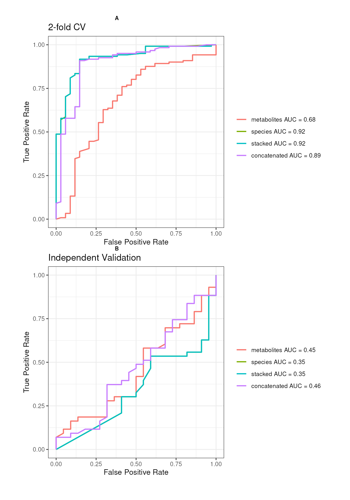
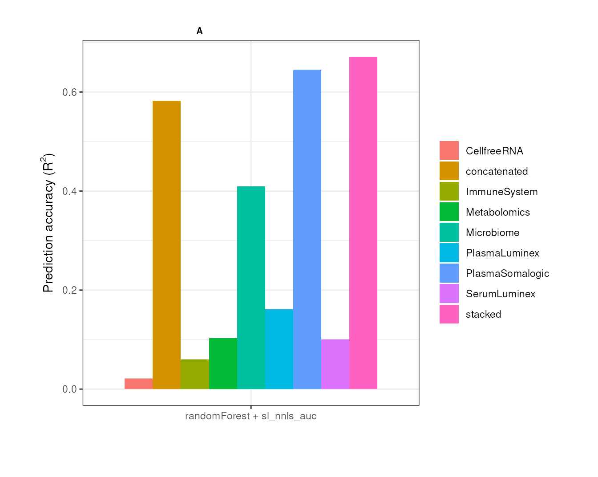
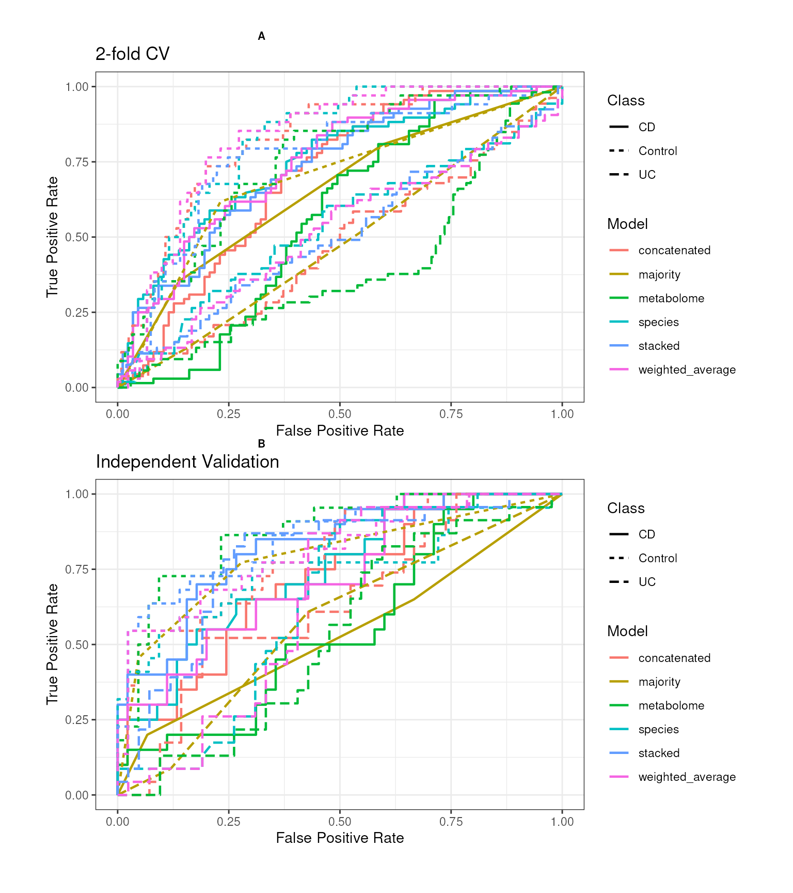
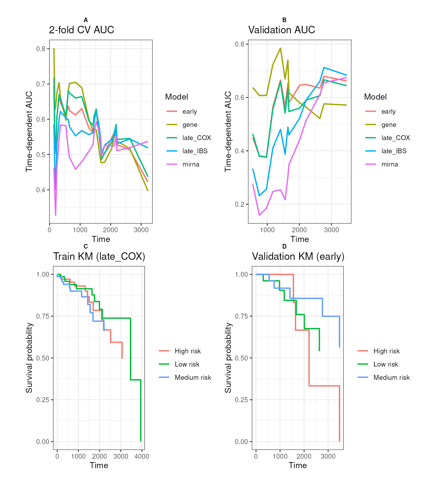

# IntegratedLearner

## Introduction

This vignette is a practical tutorial for binary, multiclass,
continuous, and survival outcome workflows in `IntegratedLearner`.

The examples use seven small MAE RDS files in `inst/extdata`, accessed
directly with
`readRDS(system.file("extdata", filename, package = "IntegratedLearner"))`.
Each assay retains at most 25 variable features selected from training
data in original order; validation uses identical feature IDs. All
original samples and outcomes are kept. These subsets demonstrate the
API; they are not intended to reproduce full-cohort scientific results.

`IntegratedLearner` is designed for multi-omics studies where each assay
layer can carry complementary signal and where users want a unified
interface for standard integrated learning or standalone cooperative
multiview learning. This makes the package a natural fit for
Bioconductor workflows built around `MultiAssayExperiment`,
`SummarizedExperiment`, and curated assay containers.

Within the Bioconductor ecosystem, the package is intended to sit after
assay assembly and harmonization, and before downstream interpretation.
IntegratedLearner focuses on supervised multi-omics
prediction/integration rather than general container management or
unsupervised integration.

### How this fits in a Bioconductor workflow

In a standard Bioconductor analysis, you would typically import or
construct assay-level data, store those assays in a
`MultiAssayExperiment`, inspect the object with standard accessors, fit
[`IntegratedLearner()`](https://himelmallick.github.io/IntegratedLearner/reference/IntegratedLearner.md),
and then carry predictions, layer weights, and feature-level summaries
into downstream interpretation or visualization steps.

### Workflow at a Glance

A compact workflow is:

1.  Construct aligned assays in `MultiAssayExperiment`.
2.  Inspect experiments and metadata with
    [`experiments()`](https://github.com/waldronlab/MultiAssayExperiment/reference/MultiAssayExperiment-methods.html),
    [`assay()`](https://rdrr.io/pkg/SummarizedExperiment/man/SummarizedExperiment-class.html),
    [`colData()`](https://rdrr.io/pkg/SummarizedExperiment/man/SummarizedExperiment-class.html),
    and
    [`sampleMap()`](https://github.com/waldronlab/MultiAssayExperiment/reference/MultiAssayExperiment-methods.html).
3.  Fit single-layer and fused predictive models with
    [`IntegratedLearner()`](https://himelmallick.github.io/IntegratedLearner/reference/IntegratedLearner.md).
4.  Feed predictions, layer weights, and feature summaries into
    downstream Bioconductor interpretation workflows.

Compared with packages that primarily focus on assay containers,
preprocessing, or narrower outcome families, `IntegratedLearner` is
centered on the modeling layer itself: it provides a common interface
for continuous, binary, multiclass, and survival prediction while
remaining compatible with standard Bioconductor data structures. In that
sense, it is intended to complement upstream Bioconductor tools rather
than replace them.

The goal is to show a complete end-to-end pattern you can adapt to your
own multi-omics study:

1.  Build correctly formatted training/validation inputs.
2.  Fit per-layer, stacked, and concatenated learners.
3.  Interpret model outputs (AUC, accuracy, balanced accuracy, R2,
    survival discrimination curves, layer weights, and feature signals).

`IntegratedLearner` supports two execution modes:

- Standard IL mode: per-layer base learners, early fusion from
  concatenated features, and late fusion through a meta-learner.
- Intermediate/cooperative mode: standalone `multiview` cooperative
  learning over feature matrices from each layer.

Cooperative learning is enabled with `run_intermediate = TRUE`. In this
mode, IntegratedLearner skips base learners, early fusion, late fusion,
and supervised screening. It is currently supported for continuous,
binary, and survival outcomes. For multiclass outcomes,
`IntegratedLearner` prints a message and ignores `run_intermediate`.

Optional feature selection workflow used in this vignette:

1.  Filtering first (`filter_method`, `filter_pct`) on training
    features.
2.  Screening second (`run_screening = TRUE`, `screen_pct`) in a
    fold-safe manner:
    - selected on fold-training only,
    - applied to fold-validation,
    - repeated for each fold,
    - repeated once on full training data for final model fit.

## Installation

IntegratedLearner was accepted into Bioconductor. Once the nightly build
succeeds, install it from a Bioconductor devel environment with:

\
`if`` ``(``!`[`requireNamespace`](https://rdrr.io/r/base/ns-load.html)`(``"BiocManager"``, quietly ``=`` ``TRUE``)``)`` ``{`\
`  `[`install.packages`](https://rdrr.io/r/utils/install.packages.html)`(``"BiocManager"``)`\
`}`\
`BiocManager``::`[`install`](https://bioconductor.github.io/BiocManager/reference/install.html)`(``"IntegratedLearner"``)`

To install directly from GitHub, use:

\
`BiocManager``::`[`install`](https://bioconductor.github.io/BiocManager/reference/install.html)`(``"himelmallick/IntegratedLearner"``)`

## Load Packages

\
`# Main package`\
[`library`](https://rdrr.io/r/base/library.html)`(`[`IntegratedLearner`](https://himelmallick.github.io/IntegratedLearner/)`)`\
\
`# Tutorial dependencies`\
[`library`](https://rdrr.io/r/base/library.html)`(`[`dplyr`](https://dplyr.tidyverse.org)`)`\
[`library`](https://rdrr.io/r/base/library.html)`(`[`ggplot2`](https://ggplot2.tidyverse.org)`)`\
[`library`](https://rdrr.io/r/base/library.html)`(`[`SuperLearner`](https://github.com/ecpolley/SuperLearner)`)`\
[`library`](https://rdrr.io/r/base/library.html)`(`[`caret`](https://github.com/topepo/caret/)`)`\
[`library`](https://rdrr.io/r/base/library.html)`(`[`cowplot`](https://wilkelab.org/cowplot/)`)`\
[`library`](https://rdrr.io/r/base/library.html)`(`[`bayesplot`](https://mc-stan.org/bayesplot/)`)`\
[`library`](https://rdrr.io/r/base/library.html)`(`[`S4Vectors`](https://bioconductor.org/packages/S4Vectors)`)`\
[`library`](https://rdrr.io/r/base/library.html)`(`[`SummarizedExperiment`](https://bioconductor.org/packages/SummarizedExperiment)`)`\
[`library`](https://rdrr.io/r/base/library.html)`(`[`MultiAssayExperiment`](http://waldronlab.io/MultiAssayExperiment/)`)`\
[`library`](https://rdrr.io/r/base/library.html)`(`[`survival`](https://github.com/therneau/survival)`)`\
`if`` ``(`[`requireNamespace`](https://rdrr.io/r/base/ns-load.html)`(``"multiview"``, quietly ``=`` ``TRUE``)``)`` ``{`\
`  `[`library`](https://rdrr.io/r/base/library.html)`(``multiview``)`\
`}`\
`if`` ``(``use_sl_bart``)`` ``{`\
`  `[`library`](https://rdrr.io/r/base/library.html)`(``bartMachine``)`\
`}`

## Input Data Contract

This vignette uses `MultiAssayExperiment` throughout and treats MAE as
the primary user-facing entry point. The older PCL input mode is still
supported for backward compatibility, but the recommended workflow is to
stay inside standard Bioconductor containers for data inspection and
model handoff.

For `IntegratedLearner`, each MAE example should satisfy:

- each omics layer is stored as a separate experiment, typically a
  `SummarizedExperiment`
- samples are aligned across experiments through MAE `colData`
- the outcome column lives in top-level `colData`
- the subject identifier column also lives in top-level `colData`

For survival workflows, `colData` should contain `time` and `event`
columns (with `event` coded as `0/1`). You can also keep a convenience
survival column such as `Y` or `outcome_surv` as a `Surv(time, event)`
object.

You can keep your own column names and map them in the wrapper:

\
`fit`` ``<-`` `[`IntegratedLearner`](https://himelmallick.github.io/IntegratedLearner/reference/IntegratedLearner.md)`(`\
`  MAE_train ``=`` ``mae_train``,`\
`  outcome_col ``=`` ``"disease_status"``,`\
`  subject_id_col ``=`` ``"participant_id"``,`\
`  family ``=`` ``stats``::`[`binomial`](https://rdrr.io/r/stats/family.html)`(``)`\
`)`

Automatic coercion in the wrapper:

- `family = gaussian()`: outcome is coerced to numeric (errors if
  conversion fails).
- binary `family = binomial()`: two classes are mapped internally to
  `{0,1}`.
- multiclass `family = binomial()`: class labels are retained.

## Standard Bioconductor Accessors

`IntegratedLearner` is intended to plug into a standard Bioconductor
workflow, not replace one. In practice, users should continue to inspect
and manipulate their inputs with the usual `MultiAssayExperiment` and
`SummarizedExperiment` accessors before modeling:

\
`PRISM_MAE`` ``<-`` `[`readRDS`](https://rdrr.io/r/base/readRDS.html)`(`[`system.file`](https://rdrr.io/r/base/system.file.html)`(`\
`  ``"extdata"``, ``"PRISM_MAE.rds"``, package ``=`` ``"IntegratedLearner"``, mustWork ``=`` ``TRUE`\
`)``)`\
\
`mae_example`` ``<-`` ``PRISM_MAE`\
\
`# Top-level sample annotations used by IntegratedLearner`\
[`head`](https://rdrr.io/r/utils/head.html)`(`[`as.data.frame`](https://rdrr.io/pkg/BiocGenerics/man/as.data.frame.html)`(``S4Vectors``::`[`DataFrame`](https://rdrr.io/pkg/S4Vectors/man/DataFrame-class.html)`(``MultiAssayExperiment``::``colData``(``mae_example``)``)``)``[``, ``1``:``4``]``)`\
`#>        Diagnosis dysbiosis_score Y subjectID`\
`#> G35127        CD       0.9341207 1    G35127`\
`#> G35128        CD       0.5962602 1    G35128`\
`#> G35152        CD       0.9505732 1    G35152`\
`#> G36347        CD       0.9966957 1    G36347`\
`#> G36348        CD       0.8475403 1    G36348`\
`#> G36349        CD       0.9569372 1    G36349`\
\
`# Available experiments/layers in the MAE`\
[`names`](https://rdrr.io/r/base/names.html)`(``MultiAssayExperiment``::`[`experiments`](https://github.com/waldronlab/MultiAssayExperiment/reference/MultiAssayExperiment-methods.html)`(``mae_example``)``)`\
`#> [1] "species"     "metabolites"`\
\
`# Pull one layer as a SummarizedExperiment`\
`se_example`` ``<-`` ``MultiAssayExperiment``::`[`experiments`](https://github.com/waldronlab/MultiAssayExperiment/reference/MultiAssayExperiment-methods.html)`(``mae_example``)``[[``1``]``]`\
[`class`](https://rdrr.io/r/base/class.html)`(``se_example``)`\
`#> [1] "SummarizedExperiment"`\
`#> attr(,"package")`\
`#> [1] "SummarizedExperiment"`\
\
`# Standard assay extraction from the layer`\
`assay_names`` ``<-`` ``SummarizedExperiment``::`[`assayNames`](https://rdrr.io/pkg/SummarizedExperiment/man/SummarizedExperiment-class.html)`(``se_example``)`\
`assay_names`\
`#> [1] "abundance"`\
[`head`](https://rdrr.io/r/utils/head.html)`(``SummarizedExperiment``::`[`assay`](https://rdrr.io/pkg/SummarizedExperiment/man/SummarizedExperiment-class.html)`(``se_example``, ``assay_names``[``1``]``)``)`\
`#>                                G35127      G35128      G35152       G36347`\
`#> Granulicella_unclassified -0.05253649 -0.05127158 -0.06133085  0.004887447`\
`#> Actinomyces_graevenitzii   1.04668500 -1.32629194 -1.51654615 -3.247989324`\
`#> Actinomyces_johnsonii     -0.70327678 -0.41575776 -0.29326475 -0.314361595`\
`#> Actinomyces_massiliensis  -0.56808952  0.14722099  0.05660884 -1.077235688`\
`#> Actinomyces_naeslundii    -0.49546119 -0.15921604 -0.03146485 -0.354377267`\
`#> Actinomyces_odontolyticus -2.60071428 -2.10648484 -3.10982881 -3.846828858`\
`#>                                 G36348      G36349      G36350      G36351`\
`#> Granulicella_unclassified -0.006164066 -0.06068187  0.01958055 -0.00291914`\
`#> Actinomyces_graevenitzii  -0.717183019 -1.50427168 -1.68488463 -0.65581069`\
`#> Actinomyces_johnsonii     -0.340485318 -0.30116753 -0.33870436 -0.37999919`\
`#> Actinomyces_massiliensis  -0.159240362  0.06245478 -0.50807364 -0.13001064`\
`#> Actinomyces_naeslundii    -0.139758576 -0.03970686 -0.27103949 -0.18096864`\
`#> Actinomyces_odontolyticus -2.238237450 -0.22407833 -2.10747316  7.10740921`\
`#>                                G36352       G36353      G36354      G36355`\
`#> Granulicella_unclassified -0.05776143 -0.007104484 -0.02798171 -0.04964912`\
`#> Actinomyces_graevenitzii  -1.44903659 -2.227858510 -1.16809841  0.28934691`\
`#> Actinomyces_johnsonii     -0.33673001 -0.631955729 -0.69300749 -0.43551469`\
`#> Actinomyces_massiliensis   4.12202564 -0.871627902 -0.47895003  0.16183585`\
`#> Actinomyces_naeslundii    -0.07679592 -0.480124737 -0.41065892 -0.17982107`\
`#> Actinomyces_odontolyticus -2.75380353 -2.700100958 -2.34537624 -1.94465517`\
`#>                                 G36356      G36357      G36358      G36359`\
`#> Granulicella_unclassified  0.001299263 -0.01103146  0.01730911 -0.07698314`\
`#> Actinomyces_graevenitzii  -0.576026671 -0.80924151 -1.72784526 -1.85085413`\
`#> Actinomyces_johnsonii     -0.431367226 -0.28121451 -0.31104465 -0.72086328`\
`#> Actinomyces_massiliensis  -0.092011992 -0.20308495 -0.52853445 -0.20756435`\
`#> Actinomyces_naeslundii    -0.234541714 -0.07794349 -0.24219244 -0.38066431`\
`#> Actinomyces_odontolyticus -1.493820959 -2.72372647 -2.33403470 -2.60201484`\
`#>                                 G36360     G36361       G36362      G36363`\
`#> Granulicella_unclassified -0.005839574 0.01800834  0.009845776 -0.05970839`\
`#> Actinomyces_graevenitzii  -0.711045786 4.42949600 -1.869001603 -1.48585999`\
`#> Actinomyces_johnsonii     -0.344436706 8.47614049 -0.220162746 -0.31302169`\
`#> Actinomyces_massiliensis  -0.156317389 8.86079698 -0.595762822  0.07122370`\
`#> Actinomyces_naeslundii    -0.143879582 6.12525018 -0.147409306 -0.05206988`\
`#> Actinomyces_odontolyticus -2.205871516 7.27449295  4.629397782  4.99684820`\
`#>                                G36365       G36366       G36367      G36368`\
`#> Granulicella_unclassified -0.06295331 -0.004217111 -0.005806513 -0.06003288`\
`#> Actinomyces_graevenitzii  -1.54723231 -0.680359624  1.168632075 -1.49199722`\
`#> Actinomyces_johnsonii     -0.27350782 -0.364193642 -0.647761278 -0.30907030`\
`#> Actinomyces_massiliensis   0.04199397 -0.141702527 -0.859936012  0.06830073`\
`#> Actinomyces_naeslundii    -0.01085982 -0.164484612 -0.496608761 -0.04794888`\
`#> Actinomyces_odontolyticus -3.27165848 -2.044041844 -2.570637221  2.90391516`\
`#>                                G36369      G36370       G36371       G36372`\
`#> Granulicella_unclassified -0.05224506 -0.01694897 -0.004866096 -0.063277806`\
`#> Actinomyces_graevenitzii  -1.34470364 -0.95943251 -0.692634089 -1.553369545`\
`#> Actinomyces_johnsonii     -0.40390360 -0.82735466 -0.356290867 -0.269556429`\
`#> Actinomyces_massiliensis   0.13845207 -0.37956896 -0.147548472  0.039071002`\
`#> Actinomyces_naeslundii    -0.14685302 -0.55077312 -0.156242600 -0.006738816`\
`#> Actinomyces_odontolyticus -2.20358264 -1.24493447  0.791680370  2.332149272`\
`#>                                G36374       G36375      G36378      G36379`\
`#> Granulicella_unclassified -0.06789735  0.009196791  0.01860708 -0.04142710`\
`#> Actinomyces_graevenitzii  -1.67901162 -1.881276067 -1.70329633 -2.59471794`\
`#> Actinomyces_johnsonii     -0.83150213 -0.212259971 -0.32685020 -0.22035883`\
`#> Actinomyces_massiliensis  -0.12572112 -0.601608767 -0.51684256 -0.34483795`\
`#> Actinomyces_naeslundii    -0.49605247 -0.139167294 -0.25867647 -0.08856765`\
`#> Actinomyces_odontolyticus -1.69576868 -3.143183056  6.35613318 -3.56165133`\
`#>                                G36380      G36381      G36382      G36383`\
`#> Granulicella_unclassified -0.04110260 -0.05224506  0.03593207 -0.05938389`\
`#> Actinomyces_graevenitzii   4.94228519  6.48054316 -1.45023842 -1.47972275`\
`#> Actinomyces_johnsonii     -0.22431021 -0.40390360 -0.38312005 -0.31697308`\
`#> Actinomyces_massiliensis  -0.34191498  0.13845207 -0.92963674  0.07414667`\
`#> Actinomyces_naeslundii    -0.09268866 -0.14685302 -0.35199511 -0.05619089`\
`#> Actinomyces_odontolyticus -3.52928540 -2.20358264 -2.94417212 -2.91563320`\
`#>                                G36384      G36385      G36386      G36387`\
`#> Granulicella_unclassified -0.02150616 -0.01135595 -0.05873491 -0.02904613`\
`#> Actinomyces_graevenitzii  -2.29256218 -0.81537874 -1.46744829 -2.47343934`\
`#> Actinomyces_johnsonii     -0.30823977 -0.27726312 -0.32487585 -0.83462299`\
`#> Actinomyces_massiliensis  -0.73424835 -0.20600792  0.07999262 -0.92534723`\
`#> Actinomyces_naeslundii    -0.21485434 -0.07382248 -0.06443290 -0.66707895`\
`#> Actinomyces_odontolyticus -4.04232502  3.86252714 -2.85090133 -2.72536270`\
`#>                                G36389      G36390      G36392      G36394`\
`#> Granulicella_unclassified  0.02814425  0.01633563 -0.02116737 -0.07503618`\
`#> Actinomyces_graevenitzii  -1.59753200 -1.74625695 -1.03921653 -1.81403073`\
`#> Actinomyces_johnsonii     -0.28828676 -0.29919049 -0.77598663  5.27878701`\
`#> Actinomyces_massiliensis  -0.99978808 -0.53730337 -0.41756761 -0.19002652`\
`#> Actinomyces_naeslundii    -0.25309097 -0.22982943 -0.49720004  2.51945997`\
`#> Actinomyces_odontolyticus -3.72095455 -2.43113250  3.65622523  6.23559551`\
`#>                                G36395      G36396      G48777      G48780`\
`#> Granulicella_unclassified  0.01958055 -0.02580121 -0.06133085 -0.05776143`\
`#> Actinomyces_graevenitzii   3.91094074 -2.41206702 -0.43401430  1.28416581`\
`#> Actinomyces_johnsonii     -0.33870436 -0.87413686 -0.29326475  6.10453778`\
`#> Actinomyces_massiliensis  -0.50807364 -0.89611750  0.05660884  2.67421984`\
`#> Actinomyces_naeslundii    -0.27103949 -0.70828901 -0.03146485 -0.07679592`\
`#> Actinomyces_odontolyticus -2.10747316  4.91222115  1.64870221  5.85895296`\
`#>                                G48781        G48783      G48784      G48786`\
`#> Granulicella_unclassified  0.02087852 -0.0006476922 -0.05675489  0.03171367`\
`#> Actinomyces_graevenitzii  -1.66033570 -0.6128500661  1.96124137  5.51434470`\
`#> Actinomyces_johnsonii     -0.35450991  2.0687611082 -0.65190875 -0.33175202`\
`#> Actinomyces_massiliensis  -0.49638175 -0.1095498280 -0.60608817 -0.96763539`\
`#> Actinomyces_naeslundii    -0.28752351 -0.2098156784  1.24942852 -0.29842203`\
`#> Actinomyces_odontolyticus -1.97800942 -1.6880165658  2.93588947  3.91180455`\
`#>                                 G48787      G48789      G48790      G48791`\
`#> Granulicella_unclassified -0.005515081 -0.01103146 -0.01070696 -0.01070696`\
`#> Actinomyces_graevenitzii  -0.704908554  4.39332806  2.07609172 -0.80310427`\
`#> Actinomyces_johnsonii     -0.348388093 -0.28121451 -0.28516590 -0.28516590`\
`#> Actinomyces_massiliensis  -0.153394417 -0.20308495 -0.20016198 -0.20016198`\
`#> Actinomyces_naeslundii    -0.148000588 -0.07794349 -0.08206449 -0.08206449`\
`#> Actinomyces_odontolyticus -2.173505582  3.96560227  5.71608938  1.57677340`\
`#>                                G48792      G48793       G48794      G48795`\
`#> Granulicella_unclassified -0.01103146 -0.01038247 -0.008760007 -0.02604906`\
`#> Actinomyces_graevenitzii  -0.80924151 -0.79696704 -0.766280879  4.07521830`\
`#> Actinomyces_johnsonii      6.92682253 -0.28911728 -0.308874220 -0.25292035`\
`#> Actinomyces_massiliensis  -0.20308495 -0.19723901 -0.182624143 -0.77516997`\
`#> Actinomyces_naeslundii    -0.07794349 -0.08618550 -0.106790529 -0.15716026`\
`#> Actinomyces_odontolyticus -2.72372647 -2.65899460 -2.497164926  1.93283843`\
`#>                                G48796       G48798      G48799     G48802`\
`#> Granulicella_unclassified  0.01601114 -0.008111022  0.02282548 -0.0090845`\
`#> Actinomyces_graevenitzii  -0.75239419  3.214224126  2.84358630 -0.7724181`\
`#> Actinomyces_johnsonii     -0.29523910 -0.316776995 -0.37821824 -0.3049228`\
`#> Actinomyces_massiliensis  -0.54022634 -0.176778198 -0.47884392 -0.1855471`\
`#> Actinomyces_naeslundii    -0.22570842 -0.115032540 -0.31224955 -0.1026695`\
`#> Actinomyces_odontolyticus -2.46349843  3.057708089  3.01664333  3.4824312`\
`#>                                G48804       G48805      G48806      G48807`\
`#> Granulicella_unclassified  0.01893157  0.006326602 -0.05321854 -0.01297841`\
`#> Actinomyces_graevenitzii  -1.69715909 -2.048447396  8.79860850  2.71750390`\
`#> Actinomyces_johnsonii     -0.33080159 -0.640808932 -0.39204943 -0.25750619`\
`#> Actinomyces_massiliensis  -0.51391959 -1.319497754  0.12968315 -0.22062279`\
`#> Actinomyces_naeslundii    -0.26279747 -0.523991309 -0.13449000 -0.05321745`\
`#> Actinomyces_odontolyticus  1.52083872 -3.828093337 -2.30068045  3.32493041`\
`#>                                G48808      G48810      G48812      G48814`\
`#> Granulicella_unclassified -0.01005798 -0.04110260 -0.02650044  0.02752833`\
`#> Actinomyces_graevenitzii   4.35102026  3.96964561  1.92658333  1.55278289`\
`#> Actinomyces_johnsonii     -0.29306867 -0.22431021 -0.40212264 -0.58370856`\
`#> Actinomyces_massiliensis  -0.19431603 -0.34191498 -0.21038121  1.49469774`\
`#> Actinomyces_naeslundii    -0.09030650 -0.09268866 -0.27813393 -0.59757813`\
`#> Actinomyces_odontolyticus  1.96683686  3.67370141  6.32296792  3.39267094`\
`#>                                G48815       G48817      G48819       G48820`\
`#> Granulicella_unclassified -0.05419201  0.002921726  0.04577656  0.007624573`\
`#> Actinomyces_graevenitzii  -1.38152703 -0.545340509  2.34867916 -2.023898466`\
`#> Actinomyces_johnsonii     -0.38019527 -0.451124162 -0.18772112 -0.656614481`\
`#> Actinomyces_massiliensis   0.12091423 -0.077397130  1.96581859 -1.307805863`\
`#> Actinomyces_naeslundii    -0.12212698 -0.255146744 -0.28134673 -0.540475333`\
`#> Actinomyces_odontolyticus -2.39777825 -1.331991287  2.74634317  0.348781581`\
`#>                                 G48821        G48822      G48823        G48826`\
`#> Granulicella_unclassified -0.008435515 -0.0003231996  1.76377322 -0.0009721848`\
`#> Actinomyces_graevenitzii   3.291973864  6.2483293085 -1.46744829 -0.6189872986`\
`#> Actinomyces_johnsonii      2.229733223 -0.4116102892 -0.32487585 -0.4037075146`\
`#> Actinomyces_massiliensis   0.885925692  0.8933731446  0.07999262 -0.1124728006`\
`#> Actinomyces_naeslundii    -0.110911535 -0.2139366844 -0.06443290 -0.2056946724`\
`#> Actinomyces_odontolyticus  5.007733793  5.4681324015 -1.11390082  4.8903973023`\
`#>                                 G48827      G48831      G48832     G48836`\
`#> Granulicella_unclassified -0.063277806 -0.01103146 -0.05321854  0.0258728`\
`#> Actinomyces_graevenitzii  -1.553369545 -0.80924151 -1.36311534  4.0891743`\
`#> Actinomyces_johnsonii     -0.269556429 -0.28121451  3.35116173 -0.2606270`\
`#> Actinomyces_massiliensis   0.039071002 -0.20308495  0.12968315  1.3085295`\
`#> Actinomyces_naeslundii    -0.006738816 -0.07794349 -0.13449000  0.7757561`\
`#> Actinomyces_odontolyticus  3.712401655 -2.72372647 -1.30068045 -1.8098504`\
`#>                                 G48838     G48839      G48840      G48841`\
`#> Granulicella_unclassified  0.006925342  0.9223679 -0.05707939 -0.03683396`\
`#> Actinomyces_graevenitzii  -1.924236695 -0.8213358  3.92099183  3.02140896`\
`#> Actinomyces_johnsonii     -0.184600260 -0.7129605  6.23945313 -0.73978969`\
`#> Actinomyces_massiliensis  -0.622069575 -0.2134103  3.86113030 -0.99549857`\
`#> Actinomyces_naeslundii    -0.110320252 -0.3724223  3.41760737 -0.56817481`\
`#> Actinomyces_odontolyticus  3.955778233  1.6931378  8.39745649 -3.50214512`\
`#>                                G48842      G72670      G72671      G72672`\
`#> Granulicella_unclassified -0.01232943 -0.06262882 -0.01297841 -0.04272507`\
`#> Actinomyces_graevenitzii   4.05319320 -1.54109508 -0.84606490 -0.42135433`\
`#> Actinomyces_johnsonii      6.20258541 -0.27745920 -0.25750619 -0.20455328`\
`#> Actinomyces_massiliensis   4.93831575  0.04491695 -0.22062279 -0.35652984`\
`#> Actinomyces_naeslundii     2.52663443 -0.01498083 -0.05321745 -0.07208363`\
`#> Actinomyces_odontolyticus  3.61065451  2.69300925 -2.91792207  1.72841300`\
`#>                                G72673      G72674      G72675      G72676`\
`#> Granulicella_unclassified  0.01276621 -0.06165534 -0.01759795 -0.02475108`\
`#> Actinomyces_graevenitzii   1.29841674  5.74354939 -0.97170697 -2.35393450`\
`#> Actinomyces_johnsonii     -0.25572523  0.71068664 -0.81945188 -0.26872590`\
`#> Actinomyces_massiliensis  -0.56945607  0.05368586 -0.38541491 -0.76347808`\
`#> Actinomyces_naeslundii    -0.18449836  3.19559594 -0.54253111 -0.17364429`\
`#> Actinomyces_odontolyticus -2.78715778  2.40625530 -1.30966634  2.26918195`\
`#>                                G72677      G72678      G72679       G72680`\
`#> Granulicella_unclassified -0.04207608 -0.05905940 -0.02960418 -0.008726947`\
`#> Actinomyces_graevenitzii  -2.60699241 -1.47358552  3.40721271  4.650455876`\
`#> Actinomyces_johnsonii     -0.21245605 -0.32092446 -0.67325056 -0.612198792`\
`#> Actinomyces_massiliensis  -0.35068390  0.07706965 -0.49356489  2.287404745`\
`#> Actinomyces_naeslundii    -0.08032564 -0.06031189 -0.39005389 -0.459519707`\
`#> Actinomyces_odontolyticus -3.62638320 -2.88326727 -2.50720591 -2.861930630`\
`#>                                G72681      G72682      G72683      G72684`\
`#> Granulicella_unclassified -0.06295331 -0.04867564  0.02120302 -0.04040337`\
`#> Actinomyces_graevenitzii   2.19187324 -1.27719408  1.12921192 -2.68824248`\
`#> Actinomyces_johnsonii     -0.27350782 -0.44736886 -0.35846130 -0.69632443`\
`#> Actinomyces_massiliensis   0.04199397  0.17060477 -0.49345878 -1.02765127`\
`#> Actinomyces_naeslundii    -0.01085982 -0.19218409  4.29854609 -0.52284374`\
`#> Actinomyces_odontolyticus  2.76693068  3.91372245 -1.94564348  2.19493040`\
`#>                                G72685      G72686       G72687        G72688`\
`#> Granulicella_unclassified -0.07763212 -0.02506128 -0.009375932  1.293047e-06`\
`#> Actinomyces_graevenitzii   5.47669458 -1.11286332 -2.270819137 -6.005756e-01`\
`#> Actinomyces_johnsonii     -0.71296051 -0.72856998 -0.604296018 -4.155617e-01`\
`#> Actinomyces_massiliensis  -0.21341030 -0.45264328 -0.892088710 -1.037039e-01`\
`#> Actinomyces_naeslundii    -0.37242229 -0.44774797 -0.451277695 -2.180577e-01`\
`#> Actinomyces_odontolyticus  3.56077819 -2.05408283 -2.926662499 -1.623285e+00`\
`#>                                G72689      G72690     G72691       G72692`\
`#> Granulicella_unclassified -0.07795662  0.02314997 0.02055403 -0.007104484`\
`#> Actinomyces_graevenitzii  -1.86926582 -1.61737507 4.61147184 -2.227858510`\
`#> Actinomyces_johnsonii     -0.70900912 -0.38216962 8.82237644 -0.631955729`\
`#> Actinomyces_massiliensis  -0.21633327 -0.47592095 5.13125652 -0.871627902`\
`#> Actinomyces_naeslundii    -0.36830129 -0.31637055 1.63645976 -0.480124737`\
`#> Actinomyces_odontolyticus  2.98644355 -1.75144788 9.83577984 -2.700100958`\
`#>                                G72693      G72694       G72695       G72696`\
`#> Granulicella_unclassified -0.02747391 -0.02650044  0.001299263  0.009521283`\
`#> Actinomyces_graevenitzii   4.96992615 -2.31240525 -0.576026671 -1.875138835`\
`#> Actinomyces_johnsonii     -0.39026848 -0.40212264 -0.431367226 -0.216211358`\
`#> Actinomyces_massiliensis  -0.21915013 -0.21038121 -0.092011992 -0.598685794`\
`#> Actinomyces_naeslundii    -0.26577091 -0.27813393 -0.234541714 -0.143288300`\
`#> Actinomyces_odontolyticus -2.16991615 -2.07281835 -1.493820959  1.322187876`\
`#>                                 G72697      G72698      G72699       G72701`\
`#> Granulicella_unclassified  0.009845776 -0.06230433 -0.05094709  0.003570712`\
`#> Actinomyces_graevenitzii  -1.869001603 -1.53495785 -1.32015471 -0.533066044`\
`#> Actinomyces_johnsonii     -0.220162746 -0.28141059 -0.41970914 -0.459026936`\
`#> Actinomyces_massiliensis  -0.595762822  0.04783992  0.15014396 -0.071551184`\
`#> Actinomyces_naeslundii    -0.147409306 -0.01910183 -0.16333704 -0.263388756`\
`#> Actinomyces_odontolyticus  2.214319598 -3.20692661 -2.07411891  7.835787130`\
`#>                                G72702       G72703      G72704      G72705`\
`#> Granulicella_unclassified -0.02700824  0.009845776 -0.02742367  0.02444794`\
`#> Actinomyces_graevenitzii  -1.14968672 -1.869001603 -2.44275318 -1.59282614`\
`#> Actinomyces_johnsonii     -0.70486165 -0.220162746 -0.85437992 -0.39797517`\
`#> Actinomyces_massiliensis  -0.47018111 -0.595762822 -0.91073236 -0.46422906`\
`#> Actinomyces_naeslundii    -0.42302194 -0.147409306 -0.68768398 -0.33285458`\
`#> Actinomyces_odontolyticus -2.24827843 -3.078451187 -2.56353302 -1.62198414`\
`#>                               G72706      G72708      G72709      G72710`\
`#> Granulicella_unclassified  0.0130907 -0.07698314  0.01893157  0.02282548`\
`#> Actinomyces_graevenitzii  -1.8076293  4.61528535  2.40557677 -1.62351230`\
`#> Actinomyces_johnsonii     -0.2596766 -0.72086328 -0.33080159 -0.37821824`\
`#> Actinomyces_massiliensis  -0.5665331 -0.20756435 -0.51391959 -0.47884392`\
`#> Actinomyces_naeslundii    -0.1886194 -0.38066431 -0.26279747 -0.31224955`\
`#> Actinomyces_odontolyticus -2.7547918 -2.60201484 -2.17220502  2.61815782`\
`#>                                G72711     G72712      G72713       G72714`\
`#> Granulicella_unclassified  0.01114375  0.0218520 -0.05094709 -0.001945663`\
`#> Actinomyces_graevenitzii  -0.20402204 -1.6419240 -1.32015471  5.192483408`\
`#> Actinomyces_johnsonii     -0.23596829 -0.3663641 -0.41970914 -0.391853353`\
`#> Actinomyces_massiliensis   5.67000638 -0.4876128  0.15014396 -0.121241718`\
`#> Actinomyces_naeslundii    -0.16389333 -0.2998865 -0.16333704  4.319849522`\
`#> Actinomyces_odontolyticus  5.05774842 -1.8809116 -2.07411891 -1.817480303`\
`#>                                G72715      G72716      G72717      G72718`\
`#> Granulicella_unclassified  0.00584216 -0.01038247 -0.01038247 -0.01330290`\
`#> Actinomyces_graevenitzii  -0.49010542 -0.79696704 -0.79696704 -0.85220213`\
`#> Actinomyces_johnsonii     -0.48668665 -0.28911728 -0.28911728 -0.25355480`\
`#> Actinomyces_massiliensis  -0.05109038 -0.19723901 -0.19723901 -0.22354576`\
`#> Actinomyces_naeslundii    -0.29223580 -0.08618550 -0.08618550 -0.04909644`\
`#> Actinomyces_odontolyticus -1.04069788 -2.65899460 -0.26939485 -2.95028801`\
`#>                                G72719      G72720      G72721      G72722`\
`#> Granulicella_unclassified -0.01265392 -0.01200493 -0.01330290 -0.01330290`\
`#> Actinomyces_graevenitzii  -0.83992767  5.15631919 -0.85220213 -0.85220213`\
`#> Actinomyces_johnsonii     -0.26145757 -0.26936035 -0.25355480 -0.25355480`\
`#> Actinomyces_massiliensis  -0.21769981 -0.21185387 -0.22354576 -0.22354576`\
`#> Actinomyces_naeslundii    -0.05733846 -0.06558047 -0.04909644 -0.04909644`\
`#> Actinomyces_odontolyticus  0.58258159  4.26804118 -2.95028801  2.32194955`\
`#>                                G72723      G72724       G72725      G72726`\
`#> Granulicella_unclassified -0.01232943 -0.01232943 -0.006488559 -0.01103146`\
`#> Actinomyces_graevenitzii  -0.83379044 -0.83379044 -0.723320251 -0.80924151`\
`#> Actinomyces_johnsonii     -0.26540896 -0.26540896 -0.336533931 -0.28121451`\
`#> Actinomyces_massiliensis  -0.21477684 -0.21477684 -0.162163335 -0.20308495`\
`#> Actinomyces_naeslundii    -0.06145946 -0.06145946 -0.135637570 -0.07794349`\
`#> Actinomyces_odontolyticus -2.85319020  2.05198151 -2.270603385 -2.72372647`\
`#>                                G72727      G72728      G72729      G72730`\
`#> Granulicella_unclassified -0.01297841 -0.01330290 -0.01297841 -0.01232943`\
`#> Actinomyces_graevenitzii  -0.84606490 -0.85220213 -0.84606490 -0.83379044`\
`#> Actinomyces_johnsonii     -0.25750619 -0.25355480 -0.25750619 -0.26540896`\
`#> Actinomyces_massiliensis  -0.22062279 -0.22354576 -0.22062279 -0.21477684`\
`#> Actinomyces_naeslundii    -0.05321745 -0.04909644 -0.05321745 -0.06145946`\
`#> Actinomyces_odontolyticus -2.91792207  1.23056949 -2.91792207  3.54596978`\
`#>                                G72731       G72732      G72733      G72734`\
`#> Granulicella_unclassified -0.01265392 -0.006813052 -0.01297841 -0.01297841`\
`#> Actinomyces_graevenitzii  -0.83992767 -0.729457484 -0.84606490 -0.84606490`\
`#> Actinomyces_johnsonii     -0.26145757 -0.332582544 -0.25750619 -0.25750619`\
`#> Actinomyces_massiliensis  -0.21769981 -0.165086307 -0.22062279 -0.22062279`\
`#> Actinomyces_naeslundii    -0.05733846 -0.131516564 -0.05321745 -0.05321745`\
`#> Actinomyces_odontolyticus  2.04674580 -2.302969319 -2.91792207 -2.91792207`\
`#>                                G72735        G72736      G72737`\
`#> Granulicella_unclassified -0.01297841  0.0009747709 -0.01362740`\
`#> Actinomyces_graevenitzii  -0.84606490 -0.5821639036 -0.85833937`\
`#> Actinomyces_johnsonii     -0.25750619 -0.4274158382 -0.24960341`\
`#> Actinomyces_massiliensis  -0.22062279 -0.0949349651 -0.22646873`\
`#> Actinomyces_naeslundii    -0.05321745 -0.2304207083 -0.04497544`\
`#> Actinomyces_odontolyticus  0.19754404 -1.5261868938  0.13542465`\
\
`# MAE sample-to-assay mapping`\
[`head`](https://rdrr.io/r/utils/head.html)`(``MultiAssayExperiment``::`[`sampleMap`](https://github.com/waldronlab/MultiAssayExperiment/reference/MultiAssayExperiment-methods.html)`(``mae_example``)``)`\
`#> DataFrame with 6 rows and 3 columns`\
`#>      assay     primary     colname`\
`#>   <factor> <character> <character>`\
`#> 1  species      G35127      G35127`\
`#> 2  species      G35128      G35128`\
`#> 3  species      G35152      G35152`\
`#> 4  species      G36347      G36347`\
`#> 5  species      G36348      G36348`\
`#> 6  species      G36349      G36349`

This is the expected Bioconductor pipeline pattern:

1.  Build assay-level objects as `SummarizedExperiment` instances.
2.  Combine them into a `MultiAssayExperiment`.
3.  Store outcome and subject identifiers in top-level `colData`.
4.  Pass the MAE into
    [`IntegratedLearner()`](https://himelmallick.github.io/IntegratedLearner/reference/IntegratedLearner.md)
    for layer-wise, early-fusion, and late-fusion modeling.

## Minimal MAE Workflow Example

The shortest end-to-end pattern starts from packaged MAE data, uses
standard Bioconductor accessors for inspection, and then fits
[`IntegratedLearner()`](https://himelmallick.github.io/IntegratedLearner/reference/IntegratedLearner.md).

\
`PRISM_MAE`` ``<-`` `[`readRDS`](https://rdrr.io/r/base/readRDS.html)`(`[`system.file`](https://rdrr.io/r/base/system.file.html)`(`\
`  ``"extdata"``, ``"PRISM_MAE.rds"``, package ``=`` ``"IntegratedLearner"``, mustWork ``=`` ``TRUE`\
`)``)`\
\
`mae_min`` ``<-`` ``PRISM_MAE`\
\
[`names`](https://rdrr.io/r/base/names.html)`(``MultiAssayExperiment``::`[`experiments`](https://github.com/waldronlab/MultiAssayExperiment/reference/MultiAssayExperiment-methods.html)`(``mae_min``)``)`\
`#> [1] "species"     "metabolites"`\
[`head`](https://rdrr.io/r/utils/head.html)`(`[`as.data.frame`](https://rdrr.io/pkg/BiocGenerics/man/as.data.frame.html)`(``S4Vectors``::`[`DataFrame`](https://rdrr.io/pkg/S4Vectors/man/DataFrame-class.html)`(``MultiAssayExperiment``::``colData``(``mae_min``)``)``)``[``, ``1``:``4``]``)`\
`#>        Diagnosis dysbiosis_score Y subjectID`\
`#> G35127        CD       0.9341207 1    G35127`\
`#> G35128        CD       0.5962602 1    G35128`\
`#> G35152        CD       0.9505732 1    G35152`\
`#> G36347        CD       0.9966957 1    G36347`\
`#> G36348        CD       0.8475403 1    G36348`\
`#> G36349        CD       0.9569372 1    G36349`\
[`head`](https://rdrr.io/r/utils/head.html)`(``MultiAssayExperiment``::`[`sampleMap`](https://github.com/waldronlab/MultiAssayExperiment/reference/MultiAssayExperiment-methods.html)`(``mae_min``)``)`\
`#> DataFrame with 6 rows and 3 columns`\
`#>      assay     primary     colname`\
`#>   <factor> <character> <character>`\
`#> 1  species      G35127      G35127`\
`#> 2  species      G35128      G35128`\
`#> 3  species      G35152      G35152`\
`#> 4  species      G36347      G36347`\
`#> 5  species      G36348      G36348`\
`#> 6  species      G36349      G36349`\
\
`se_min`` ``<-`` ``MultiAssayExperiment``::`[`experiments`](https://github.com/waldronlab/MultiAssayExperiment/reference/MultiAssayExperiment-methods.html)`(``mae_min``)``[[``1``]``]`\
`SummarizedExperiment``::`[`assayNames`](https://rdrr.io/pkg/SummarizedExperiment/man/SummarizedExperiment-class.html)`(``se_min``)`\
`#> [1] "abundance"`\
[`dim`](https://rdrr.io/r/base/dim.html)`(``SummarizedExperiment``::`[`assay`](https://rdrr.io/pkg/SummarizedExperiment/man/SummarizedExperiment-class.html)`(``se_min``, ``SummarizedExperiment``::`[`assayNames`](https://rdrr.io/pkg/SummarizedExperiment/man/SummarizedExperiment-class.html)`(``se_min``)``[``1``]``)``)`\
`#> [1]  25 155`\
\
`fit_min`` ``<-`` `[`IntegratedLearner`](https://himelmallick.github.io/IntegratedLearner/reference/IntegratedLearner.md)`(`\
`  MAE_train ``=`` ``mae_min``,`\
`  experiment ``=`` `[`names`](https://rdrr.io/r/base/names.html)`(``MultiAssayExperiment``::`[`experiments`](https://github.com/waldronlab/MultiAssayExperiment/reference/MultiAssayExperiment-methods.html)`(``mae_min``)``)``[``1``:``2``]``,`\
`  assay.type ``=`` `[`rep`](https://rdrr.io/r/base/rep.html)`(``"abundance"``, ``2``)``,`\
`  folds ``=`` ``2``,`\
`  base_learner ``=`` ``"SL.mean"``,`\
`  run_stacked ``=`` ``FALSE``,`\
`  run_concat ``=`` ``FALSE``,`\
`  family ``=`` ``stats``::`[`binomial`](https://rdrr.io/r/stats/family.html)`(``)`\
`)`\
\
[`names`](https://rdrr.io/r/base/names.html)`(``fit_min``)`\
`#>  [1] "model_fits"                         "SL_fits"                           `\
`#>  [3] "X_train_layers"                     "Y_train"                           `\
`#>  [5] "yhat.train"                         "base_learner"                      `\
`#>  [7] "meta_learner"                       "base_screener"                     `\
`#>  [9] "base_screener_used"                 "screening_used"                    `\
`#> [11] "run_concat"                         "run_stacked"                       `\
`#> [13] "run_intermediate"                   "cooperative_rho_grid"              `\
`#> [15] "cooperative_s"                      "drop_poor_performing_layers"       `\
`#> [17] "fusion_layers_retained"             "fusion_layers_removed"             `\
`#> [19] "fusion_layer_scores"                "fusion_layer_metric"               `\
`#> [21] "fusion_layer_threshold"             "family"                            `\
`#> [23] "feature.names"                      "test"                              `\
`#> [25] "train_out"                          "AUC.train"                         `\
`#> [27] "accuracy.train"                     "balanced_accuracy.train"           `\
`#> [29] "metrics.train"                      "feature_importance_signed"         `\
`#> [31] "feature_importance_signed_by_layer" "folds"                             `\
`#> [33] "cvControl"                          "time"                              `\
`#> [35] "input_mode"                         "column_map"`

## Parameter Reference (Conbin, Multiclass, and Survival)

Set the seed before fitting to reproduce cross-validation splits and
stochastic model fitting. Progress and the fit summary are optional:

\
[`set.seed`](https://rdrr.io/r/base/Random.html)`(``123``)`\
`fit`` ``<-`` ``progressr``::`[`with_progress`](https://progressr.futureverse.org/reference/with_progress.html)`(`\
`  `[`IntegratedLearner`](https://himelmallick.github.io/IntegratedLearner/reference/IntegratedLearner.md)`(`\
`    MAE_train ``=`` ``mae_min``,`\
`    experiment ``=`` `[`names`](https://rdrr.io/r/base/names.html)`(``MultiAssayExperiment``::`[`experiments`](https://github.com/waldronlab/MultiAssayExperiment/reference/MultiAssayExperiment-methods.html)`(``mae_min``)``)``[``1``:``2``]``,`\
`    assay.type ``=`` `[`rep`](https://rdrr.io/r/base/rep.html)`(``"abundance"``, ``2``)``,`\
`    folds ``=`` ``2``, base_learner ``=`` ``"SL.mean"``,`\
`    run_stacked ``=`` ``FALSE``, run_concat ``=`` ``FALSE``, family ``=`` ``stats``::`[`binomial`](https://rdrr.io/r/stats/family.html)`(``)`\
`  ``)`\
`)`\
[`print`](https://rdrr.io/r/base/print.html)`(``fit``)`

To show progress from a non-interactive script, pass `enable = TRUE` to
[`progressr::with_progress()`](https://progressr.futureverse.org/reference/with_progress.html).

### Common Wrapper Parameters (`IntegratedLearner`)

| Parameter | Default | Applies to | Description |
|----|----|----|----|
| `MAE_train`, `MAE_valid` | `NULL` | all | MAE-mode inputs (training and optional validation). |
| `PCL_train`, `PCL_valid` | `NULL` | all | Legacy tabular inputs retained for backward compatibility, but not used in this vignette. |
| `experiment` | `NULL` | MAE mode | Selected MAE experiment names/indices; defaults to all experiments. |
| `assay.type` | `NULL` | MAE mode | Assay names per selected experiment. |
| `outcome_col` | `"Y"` | all | Outcome column name in MAE `colData` (or tabular sample metadata, if using PCL mode). |
| `subject_id_col` | `"subjectID"` | all | Subject identifier column name in MAE `colData` (or tabular sample metadata, if using PCL mode). |
| `na.rm` | `FALSE` | all | Drop features with missing values after extraction/prep. |
| `folds` | `5` | all | Outer CV folds. |
| `base_learner` | `"sl_bart"` | standard IL mode | Base learner. Standard `SuperLearner` learners still use `SL.*` IDs for continuous/binary, while IntegratedLearner wrappers use snake_case IDs such as `sl_bart`; multiclass uses native IDs (for example `randomforest`, `xgboost`, `mbart`), and survival runs should use a supported `surv.*` ID. Not used when `run_intermediate = TRUE`. |
| `filter_method` | `NULL` | all | Optional feature filtering method: `"prevalence"` or `"variance"`. |
| `filter_pct` | `NULL` | all | Optional retention percentage in `(0,100]` for filtering. |
| `run_screening` | `FALSE` | standard IL mode | Enable supervised screening. Ignored when `run_intermediate = TRUE`. |
| `screen_pct` | `NULL` | all | Retention percentage in `(0,100]` for screening. Required when screening is enabled. |
| `prevalence_pct` | `NULL` | all | Deprecated alias for prevalence filtering (`filter_method = "prevalence"`). |
| `drop_poor_performing_layers` | `FALSE` | standard IL mode | If `TRUE`, removes layers with poor single-layer performance from early and late fusion only (AUC \< 0.5 for binary, R² \< 0.5 for continuous, C-index \< 0.5 for survival). Single-layer results are still retained. Ignored when `run_intermediate = TRUE`. |
| `run_intermediate` | `FALSE` | continuous, binary, survival | Enables standalone direct cooperative learning through `multiview`. Base learners, early fusion, late fusion, and supervised screening are skipped. Multiclass fits print a message and ignore this option. Requires at least 3 CV folds. |
| `cooperative_rho` | `c(0, 0.1, 0.25, 0.5, 1)` | continuous, binary, survival | Candidate agreement-penalty values. `IntegratedLearner` fits one [`cv.multiview()`](https://rdrr.io/pkg/multiview/man/cv.multiview.html) model per `rho` using the same fold assignments, then keeps the best `rho` by CV score. |
| `cooperative_s` | `"lambda.min"` | continuous, binary, survival | Lambda selection used for cooperative predictions. Can be `"lambda.min"`, `"lambda.1se"`, or a numeric lambda. |
| `cooperative_type_measure` | `NULL` | continuous, binary, survival | Optional `multiview` CV metric. Defaults are MSE for gaussian, AUC for binomial, and Harrell’s C for survival. |
| `family` | [`gaussian()`](https://rdrr.io/r/stats/family.html) | all | Non-survival: [`gaussian()`](https://rdrr.io/r/stats/family.html)/[`binomial()`](https://rdrr.io/r/stats/family.html). Multiclass is auto-detected when `family = binomial()` and outcome has more than two classes. Survival is auto-detected from metadata or family. |
| `...` | — | all | Additional arguments for the selected fitter (`IL_conbin`, `IL_multiclass`, or `ILsurv`). |

### Conbin-Specific Parameters (Continuous/Binary Path)

| Parameter | Default | Description |
|----|----|----|
| `base_screener` | `"All"` | Deprecated compatibility parameter. Prefer `run_screening` + `screen_pct`. |
| `meta_learner` | `"sl_nnls_auc"` | Stacked meta learner for late fusion. |
| `run_stacked` | `TRUE` | Enables late-fusion stacked model. |
| `run_concat` | `TRUE` | Enables early-fusion concatenated model. |
| `refit.stack` | `FALSE` | Refit stacked learner on full data for final predictions. |

### Multiclass-Specific Parameters (Native Multiclass Path)

| Parameter | Default | Description |
|----|----|----|
| `base_learner` | `"glmnet"` | Native multiclass learner per layer and for concatenated fit. Supported: `glmnet`, `randomforest`, `ranger`, `xgboost`, `mbart`, `multinom`. |
| `meta_learner` | `"glmnet"` | Native multiclass learner used for stacked fusion. |
| `base_screener` | `"All"` | Deprecated compatibility parameter. Prefer `run_screening` + `screen_pct`. |
| `run_stacked` | `TRUE` | Enables late-fusion stacked multiclass model. |
| `run_majority` | `TRUE` | Returns hard voting across layers, independently of `run_stacked`. Ties use the first training class. |
| `run_weighted` | `TRUE` | Returns learned probability averaging, independently of `run_stacked`. Nonnegative layer weights sum to one and minimize OOF multiclass log loss. |
| `run_concat` | `TRUE` | Enables early-fusion concatenated multiclass model. |
| `run_intermediate` | `FALSE` | Not supported for multiclass outcomes; if set to `TRUE`, a message is printed and the option is ignored. |
| `folds` | `5` | Subject-level CV folds for OOF multiclass probabilities. |
| `run_screening`, `screen_pct` | `FALSE`, `NULL` | Fold-safe multiclass screening (glmnet-based) after optional filtering. |

### Survival-Specific Parameters (via `...`)

| Parameter | Default | Description |
|----|----|----|
| `do_early_fusion` | `TRUE` | Train an early-fusion survival model on all features. |
| `t_vec`, `t_vec_probs` | `NULL`, quantiles | Time grid used in COX-style weighting summaries. |
| `layer_score` | `"sum"` | Aggregation of cumulative hazard increments (`sum`, `mean`, `l2`). |
| `weight_lambda` | `0.02` | Regularization strength for COX weighting optimizer. |
| `weight_penalty` | `"l2_to_uniform"` or `"entropy"` | Penalty used while learning survival late-fusion weights. |
| `weight_cap` | `1.0` | Optional cap on individual layer weights. |
| `optim_maxit_cox` | `4000` | Max iterations for COX weighting optimization. |
| `optim_maxit_ibs` | `300` | Max iterations for IBS weighting optimization. |
| `ibs_shrink_to_uniform` | `0` | Shrink IBS weights toward uniform blend. |

## Supported Models and Fusion Modules

### Supported Models

| Path | Supported base models |
|----|----|
| Continuous/Binary (`IL_conbin`) | Any `SuperLearner`-compatible learner available in your R session. Package wrappers include `sl_bart`, `sl_lasso`, `sl_enet`, `sl_glmnet2`, and `sl_horseshoe`, while standard SuperLearner learners such as `SL.glm` and `SL.randomForest` keep their original `SL.*` names. |
| Multiclass (`IL_multiclass`) | Native multiclass learner IDs: `glmnet`, `randomforest`, `ranger`, `xgboost`, `mbart`, `multinom`. |
| Survival (`ILsurv`) | Built-in survival learner IDs: `surv.coxph`, `surv.glmnet`, `surv.ranger`, `surv.ranger.extratrees`, `surv.ranger.maxstat`, `surv.ranger.C`, `surv.rfsrc`, `surv.coxboost`, `surv.gbm`, `surv.xgboost.cox`, `surv.xgboost.aft`, `surv.mboost`, `surv.bart`. |

### Supported Fusion Outputs

| Path | Single-layer | Early fusion | Late fusion | Cooperative/intermediate fusion |
|----|----|----|----|----|
| Continuous/Binary | Yes in standard IL mode | `run_concat = TRUE` in standard IL mode | `run_stacked = TRUE` with `meta_learner` in standard IL mode | Standalone `run_intermediate = TRUE` via `multiview` |
| Multiclass | Yes | `run_concat = TRUE` | Stacking, majority voting, and learned probability averaging, all enabled by default with independent flags | Not supported; prints a message and is ignored |
| Survival | Yes (`train_out$single`) in standard IL mode | `do_early_fusion = TRUE` in standard IL mode | Weighted layer blending with both `IBS` and `COX` outputs returned in standard IL mode | Standalone `run_intermediate = TRUE` via `multiview` Cox model |

## Output Reference: What You Get and How to Access It

This section summarizes the outputs produced by each integration method
and where to find weights/importance values.

### Conbin Outputs (Binary/Continuous)

| Method | What it returns | Where to access |
|----|----|----|
| Single-layer (per omics layer) | Layer-specific predictions and metrics | `fit$yhat.train[, layer_name]`, `fit$yhat.test[, layer_name]` (if validation), `fit$AUC.train` / `fit$AUC.test`, `fit$accuracy.train` / `fit$accuracy.test`, `fit$balanced_accuracy.train` / `fit$balanced_accuracy.test` (binomial), `fit$R2.train` / `fit$R2.test` (gaussian) |
| Early fusion (concatenated) | One model on all features concatenated | Enable with `run_concat = TRUE`; outputs in `fit$yhat.train[, "concatenated"]`, `fit$model_fits$model_concat`, `fit$SL_fits$SL_fit_concat` |
| Late fusion (stacked) | Meta-model over layer-level predictions | Enable with `run_stacked = TRUE`; outputs in `fit$yhat.train[, "stacked"]`, `fit$model_fits$model_stacked`, `fit$SL_fits$SL_fit_stacked` |
| Cooperative/intermediate fusion | Standalone cooperative `multiview` model trained on layer feature matrices | Enable with `run_intermediate = TRUE`; outputs in `fit$yhat.train[, "cooperative"]`, `fit$yhat.test[, "cooperative"]`, `fit$model_fits$model_cooperative`, `fit$cooperative_rho`, `fit$cooperative_rho_scores`, and coefficient-based cooperative importance fields. No base learner, early-fusion, or late-fusion objects are returned in this mode. |
| Layer weights (stacked) | Relative contribution of each layer in late fusion | `fit$weights` (available when `meta_learner = "sl_nnls_auc"` and `run_stacked = TRUE`) |
| Binary metric table | Per-model AUC, accuracy, and balanced accuracy | `fit$metrics.train` and `fit$metrics.test` (if validation provided) |

### Multiclass Outputs

| Method | What it returns | Where to access |
|----|----|----|
| Single-layer (per omics layer) | Layer-wise multiclass probability and class predictions | `fit$prob.train[[layer_name]]`, `fit$class.train[, layer_name]`, plus validation analogs `fit$prob.test[[layer_name]]`, `fit$class.test[, layer_name]` |
| Early fusion (concatenated) | One multiclass model on concatenated features | Enable with `run_concat = TRUE`; outputs in `fit$prob.train$concatenated`, `fit$class.train[, "concatenated"]`, `fit$model_fits$model_concat` |
| Late fusion (stacked) | Multiclass meta-model over OOF layer probabilities | Enable with `run_stacked = TRUE`; outputs in `fit$prob.train$stacked`, `fit$class.train[, "stacked"]`, `fit$model_fits$model_stacked` |
| Late fusion (majority) | Per-class vote fractions and the class with the most votes | Enable with `run_majority = TRUE`; `fit$prob.train$majority`, `fit$class.train$majority`, `fit$train_out$late$majority` |
| Late fusion (learned average) | Probability average with nonnegative layer weights summing to one | Enable with `run_weighted = TRUE`; `fit$prob.train$weighted_average`, `fit$class.train$weighted_average`, `fit$train_out$late$weighted_average` |
| Grouped results | Survival-style `single`, `early`, and `late` entries for all enabled methods | `fit$train_out`, `fit$valid_out`; `fit$late_methods` lists the late-fusion methods |
| Learned layer weights | Final weights and weights fitted outside each training fold | `fit$model_fits$model_weighted$weights`, `fit$train_out$late$weighted_average$weights_by_fold` |
| Cooperative/intermediate fusion | Not supported for multiclass outcomes | `run_intermediate = TRUE` prints a message and is ignored; no cooperative probability object is returned |
| Multiclass performance metrics | Accuracy, balanced accuracy, one-vs-rest AUC, and log-loss | `fit$metrics.train` and `fit$metrics.test` (if validation provided) |
| Feature-selection metadata | Filtering/screening settings used in fit | `fit$filter_method`, `fit$filter_pct`, `fit$prevalence_pct`, `fit$screening_used`, `fit$screen_method`, `fit$screen_pct` |
| Screened feature sets | Features retained by fold-safe screening | `fit$selected_features_by_layer`, `fit$selected_features_concat` |

Every grouped fusion entry contains `train_prob` and `train_class` (or
`valid_prob` and `valid_class`) and a `metrics` table. Scalar metrics
are also available as `train_accuracy`, `train_balanced_accuracy`,
`train_auc`, and `train_logloss`, with analogous `valid_` names for
validation. Single-layer entries hold probability lists and class data
frames covering all layers. Prediction returns the same `valid_out`
structure; without outcome labels, predictions remain available,
`metrics` is `NULL`, and scalar metrics are absent. Without validation
data, `fit$valid_out` is `NULL`. Disabled early fusion gives
`early = NULL`; disabled late methods are omitted from `late`. Flat
outputs remain available for compatibility.

Both the final stack and the final learned average train on OOF layer
probabilities. Training predictions for the average fit weights outside
each held-out fold. These procedures do not replace fully nested
evaluation of the complete pipeline; use an untouched validation set or
outer CV for assessment. Majority vote fractions are not calibrated
probabilities, so its log loss should be interpreted accordingly. Both
layer-level and final voting ties use the first class in
`fit$class_levels`.

### Survival Outputs (Single/Early/Late)

| Method | Training outputs | Validation outputs |
|----|----|----|
| Single-layer | `fit$train_out$single$metrics`, `fit$train_out$single$train_risk` | `fit$valid_out$single$valid_cindex`, `fit$valid_out$single$valid_auc`, `fit$valid_out$single$valid_risk` |
| Early fusion | `fit$train_out$early$train_cindex`, `fit$train_out$early$train_auc`, `fit$train_out$early$train_risk` | `fit$valid_out$early$valid_cindex`, `fit$valid_out$early$valid_auc`, `fit$valid_out$early$valid_risk` |
| Late fusion | `fit$train_out$late$IBS` and `fit$train_out$late$COX`, each containing weights, C-index, time-dependent AUC, and risks | `fit$valid_out$late$IBS` and `fit$valid_out$late$COX`, with the analogous validation metrics |
| Cooperative/intermediate fusion | Standalone `fit$train_out$cooperative`, containing the selected `multiview` model, C-index, time-dependent AUC, risk scores, and coefficient-based feature-importance scores | `fit$valid_out$cooperative`, with analogous validation metrics and risk scores. `single`, `early`, and `late` outputs are `NULL` in this mode. |
| Survival plotting payload | `fit$surv_plot_data$train` | `fit$surv_plot_data$valid` |

### Importance Outputs (Conbin, Multiclass, and Survival)

| Importance type | Where to access | Notes |
|----|----|----|
| Binary and continuous early-fusion importance | `fit$train_out$early$combined_importance` | Native scores from the fitted concatenated model when `run_concat = TRUE`. |
| Binary and continuous late-fusion importance | `fit$train_out$late$stacked$feature_importance_by_layer` | Native scores from the fitted base model for each retained layer when `run_stacked = TRUE`. |
| Binary and continuous weighted late-fusion importance | `fit$train_out$late$stacked$combined_importance` | Native feature scores multiplied by the normalized layer weights for `sl_nnls_auc`, with `layer::feature` names. |
| Conbin signed global feature importance | `fit$feature_importance_signed` | Signed one-feature-at-a-time regression coefficients for standard binary and continuous fits, ranked by absolute value. |
| Conbin signed per-layer importance | `fit$feature_importance_signed_by_layer` | The same univariate coefficients grouped by `featureType`. |
| Cooperative absolute importance | `fit$cooperative_feature_importance` and `fit$cooperative_feature_importance_by_layer` | Absolute selected-model `multiview` coefficients; available when `run_intermediate = TRUE`. |
| Cooperative signed importance | `fit$cooperative_feature_importance_signed` and `fit$cooperative_feature_importance_signed_by_layer` | Signed selected-model `multiview` coefficients; available when `run_intermediate = TRUE`. |
| Multiclass global feature importance (unsigned) | `fit$feature_importance_global` | Named vector of mean absolute class-association scores, ranked highest first. |
| Multiclass signed importance by class | `fit$feature_importance_signed_by_class` | Feature-by-class matrix of signed class-association scores. |
| Multiclass signed importance by layer and class | `fit$feature_importance_signed_by_layer_by_class` | List of feature-by-class matrices, one per omics layer; features ranked by mean absolute score across classes. |
| Survival signed per-layer importance | `fit$train_out$single$feature_importance_signed_by_layer` | List of unweighted signed feature-importance scores from each single-layer survival base model. |
| Cooperative survival importance | `fit$train_out$cooperative$feature_importance` and `fit$train_out$cooperative$feature_importance_by_layer` | Absolute selected-model `multiview` Cox coefficients; available when `run_intermediate = TRUE`. |
| Cooperative survival signed importance | `fit$train_out$cooperative$feature_importance_signed` and `fit$train_out$cooperative$feature_importance_signed_by_layer` | Signed selected-model `multiview` Cox coefficients; available when `run_intermediate = TRUE`. |
| Survival early-fusion combined importance | `fit$train_out$early$combined_importance` | Available when `do_early_fusion = TRUE`. |
| Survival late-fusion combined importance | `fit$train_out$late$IBS$combined_importance` or `fit$train_out$late$COX$combined_importance` | Weighted signed importance; names are prefixed like `layer::feature`. |
| BART-specific layer importance (optional) | `bartMachine::investigate_var_importance(fit$model_fits$model_layers[[layer]], plot = FALSE)` | Only for BART-based conbin fits (`base_learner = "sl_bart"`). |

Native fusion importance for binary and continuous outcomes supports a
single `base_learner` from the following list.

| `base_learner` | Importance from the fitted model |
|----|----|
| `SL.xgboost` | Split gain |
| `SL.glmnet`, `sl_lasso`, `sl_glmnet2`, `sl_enet` | Absolute coefficients at the selected penalty |
| `SL.ranger` | Impurity decrease, enabled by IntegratedLearner at fitting time |
| `SL.randomForest` | Mean decrease in impurity |
| `SL.gbm` | Relative influence at the selected number of trees |
| `sl_bart` | Posterior split inclusion proportions |
| `SL.glm` | Absolute logistic or linear regression coefficients |

With feature screening, each vector covers the features retained by its
fitted model. The default `sl_nnls_auc` stack returns `layer_weights`
alongside its weighted feature vector. If you choose another
meta-learner from the table,
`fit$train_out$late$stacked$layer_importance` reports the stack’s native
importance for the layer predictions. The weighted feature vector is
exclusive to `sl_nnls_auc`.

### Quick Access Snippets

\
`# ---- Conbin: weights + top features ----`\
`fit``$``weights`\
[`head`](https://rdrr.io/r/utils/head.html)`(``fit``$``train_out``$``early``$``combined_importance``, ``20``)`\
[`head`](https://rdrr.io/r/utils/head.html)`(``fit``$``train_out``$``late``$``stacked``$``feature_importance_by_layer``[[``1``]``]``, ``20``)`\
[`head`](https://rdrr.io/r/utils/head.html)`(``fit``$``train_out``$``late``$``stacked``$``combined_importance``, ``20``)`\
`fit``$``cooperative_rho`\
`fit``$``cooperative_rho_scores`\
[`head`](https://rdrr.io/r/utils/head.html)`(``fit``$``yhat.train``[``, ``"cooperative"``]``, ``10``)`\
[`head`](https://rdrr.io/r/utils/head.html)`(``fit``$``cooperative_feature_importance``, ``20``)`\
[`head`](https://rdrr.io/r/utils/head.html)`(``fit``$``cooperative_feature_importance_by_layer``[[``1``]``]``, ``20``)`\
[`head`](https://rdrr.io/r/utils/head.html)`(``fit``$``feature_importance_signed``, ``20``)`\
[`names`](https://rdrr.io/r/base/names.html)`(``fit``$``feature_importance_signed_by_layer``)`\
[`head`](https://rdrr.io/r/utils/head.html)`(``fit``$``feature_importance_signed_by_layer``[[``1``]``]``, ``20``)`\
\
`# ---- Multiclass: metrics + class probabilities + importance ----`\
`fit_mc``$``metrics.train`\
`fit_mc``$``metrics.test`\
[`head`](https://rdrr.io/r/utils/head.html)`(``fit_mc``$``class.train``)`\
[`head`](https://rdrr.io/r/utils/head.html)`(``fit_mc``$``class.test``)`\
[`head`](https://rdrr.io/r/utils/head.html)`(``fit_mc``$``prob.train``$``stacked``)`\
[`head`](https://rdrr.io/r/utils/head.html)`(``fit_mc``$``feature_importance_global``, ``20``)`\
[`head`](https://rdrr.io/r/utils/head.html)`(``fit_mc``$``feature_importance_signed_by_class``[``, ``1``, drop ``=`` ``FALSE``]``, ``20``)`\
[`head`](https://rdrr.io/r/utils/head.html)`(``fit_mc``$``feature_importance_signed_by_layer_by_class``[[``1``]``]``, ``20``)`\
\
`# ---- Survival: late-fusion weights + top combined features ----`\
`fit_surv``$``train_out``$``late``$``IBS``$``weights`\
`fit_surv``$``train_out``$``late``$``COX``$``weights`\
`fit_surv``$``train_out``$``cooperative``$``train_cindex`\
`fit_surv``$``cooperative_rho`\
[`head`](https://rdrr.io/r/utils/head.html)`(``fit_surv``$``train_out``$``cooperative``$``feature_importance``, ``20``)`\
[`head`](https://rdrr.io/r/utils/head.html)`(``fit_surv``$``train_out``$``cooperative``$``feature_importance_by_layer``[[``1``]``]``, ``20``)`\
[`names`](https://rdrr.io/r/base/names.html)`(``fit_surv``$``train_out``$``single``$``feature_importance_signed_by_layer``)`\
[`head`](https://rdrr.io/r/utils/head.html)`(``fit_surv``$``train_out``$``single``$``feature_importance_signed_by_layer``[[``1``]``]``, ``20``)`\
[`head`](https://rdrr.io/r/utils/head.html)`(``fit_surv``$``train_out``$``late``$``IBS``$``combined_importance``, ``20``)`\
[`head`](https://rdrr.io/r/utils/head.html)`(``fit_surv``$``train_out``$``late``$``COX``$``combined_importance``, ``20``)`\
\
`# ---- Survival: inspect all fusion branches ----`\
`fit_surv``$``train_out``$``single`\
`fit_surv``$``train_out``$``early`\
`fit_surv``$``train_out``$``late`

## Example 1: Binary Outcome (IBD Classification)

This section uses the packaged PRISM and NLIBD `MultiAssayExperiment`
fixtures for classifying IBD status.

### Step 1: Load and Inspect Training and Validation Data

\
`PRISM_MAE`` ``<-`` `[`readRDS`](https://rdrr.io/r/base/readRDS.html)`(`[`system.file`](https://rdrr.io/r/base/system.file.html)`(`\
`  ``"extdata"``, ``"PRISM_MAE.rds"``, package ``=`` ``"IntegratedLearner"``, mustWork ``=`` ``TRUE`\
`)``)`\
`NLIBD_MAE`` ``<-`` `[`readRDS`](https://rdrr.io/r/base/readRDS.html)`(`[`system.file`](https://rdrr.io/r/base/system.file.html)`(`\
`  ``"extdata"``, ``"NLIBD_MAE.rds"``, package ``=`` ``"IntegratedLearner"``, mustWork ``=`` ``TRUE`\
`)``)`\
`mae_train`` ``<-`` ``PRISM_MAE`\
`mae_valid`` ``<-`` ``NLIBD_MAE`\
\
[`head`](https://rdrr.io/r/utils/head.html)`(``MultiAssayExperiment``::``colData``(``mae_train``)``)`\
`#> DataFrame with 6 rows and 4 columns`\
`#>          Diagnosis dysbiosis_score         Y   subjectID`\
`#>        <character>       <numeric> <numeric> <character>`\
`#> G35127          CD        0.934121         1      G35127`\
`#> G35128          CD        0.596260         1      G35128`\
`#> G35152          CD        0.950573         1      G35152`\
`#> G36347          CD        0.996696         1      G36347`\
`#> G36348          CD        0.847540         1      G36348`\
`#> G36349          CD        0.956937         1      G36349`\
[`names`](https://rdrr.io/r/base/names.html)`(``MultiAssayExperiment``::`[`experiments`](https://github.com/waldronlab/MultiAssayExperiment/reference/MultiAssayExperiment-methods.html)`(``mae_train``)``)`\
`#> [1] "species"     "metabolites"`\
[`table`](https://rdrr.io/pkg/BiocGenerics/man/table.html)`(``MultiAssayExperiment``::``colData``(``mae_train``)``$``Y``)`\
`#> `\
`#>   0   1 `\
`#>  34 121`

### Step 2: Inspect Layer Assays

\
[`vapply`](https://rdrr.io/r/base/lapply.html)`(`\
`  ``MultiAssayExperiment``::`[`experiments`](https://github.com/waldronlab/MultiAssayExperiment/reference/MultiAssayExperiment-methods.html)`(``mae_train``)``,`\
`  ``function``(``se``)`` `[`nrow`](https://rdrr.io/pkg/BiocGenerics/man/nrow.html)`(``SummarizedExperiment``::`[`assay`](https://rdrr.io/pkg/SummarizedExperiment/man/SummarizedExperiment-class.html)`(``se``, ``"abundance"``)``)``,`\
`  `[`integer`](https://rdrr.io/r/base/integer.html)`(``1``)`\
`)`\
`#>     species metabolites `\
`#>          25          25`

### Step 3: Fit the Model

`IntegratedLearner` fits one model per layer (`base_learner`) and then
combines layer-level predictions with a meta-learner (`meta_learner`).

\
`fit`` ``<-`` `[`IntegratedLearner`](https://himelmallick.github.io/IntegratedLearner/reference/IntegratedLearner.md)`(`\
`  MAE_train ``=`` ``mae_train``,`\
`  MAE_valid ``=`` ``mae_valid``,`\
`  folds ``=`` ``2``,`\
`  base_learner ``=`` ``"SL.randomForest"``,`\
`  meta_learner ``=`` ``"sl_nnls_auc"``,`\
`  filter_method ``=`` ``"prevalence"``,`\
`  filter_pct ``=`` ``40``,`\
`  run_screening ``=`` ``TRUE``,`\
`  screen_pct ``=`` ``30``,`\
`  family ``=`` `[`binomial`](https://rdrr.io/r/stats/family.html)`(``)`\
`)`\
`#> Loading required namespace: randomForest`

### Step 4: Inspect and Interpret Outputs

Core outputs for binary tasks include:

- `fit$AUC.train` and `fit$AUC.test`: AUC per layer and fusion model.
- `fit$accuracy.train` and `fit$accuracy.test`: thresholded accuracy per
  layer and fusion model.
- `fit$balanced_accuracy.train` and `fit$balanced_accuracy.test`:
  balanced accuracy per layer and fusion model.
- `fit$metrics.train` and `fit$metrics.test`: compact metric tables with
  AUC, accuracy, and balanced accuracy.
- `fit$weights`: layer contributions in the stacked model (when
  `sl_nnls_auc` is used).
- `fit$yhat.train` and `fit$yhat.test`: predicted probabilities.

\
`fit``$``AUC.train`\
`#>  metabolites      species      stacked concatenated `\
`#>        0.680        0.925        0.924        0.891`\
`fit``$``AUC.test`\
`#>  metabolites      species      stacked concatenated `\
`#>        0.450        0.347        0.347        0.461`\
`fit``$``accuracy.train`\
`#>  metabolites      species      stacked concatenated `\
`#>    0.7612903    0.8967742    0.8967742    0.8709677`\
`fit``$``balanced_accuracy.train`\
`#>  metabolites      species      stacked concatenated `\
`#>    0.5933398    0.8492951    0.8492951    0.7693243`\
`fit``$``metrics.test`\
`#>          model   auc  accuracy balanced_accuracy`\
`#> 1  metabolites 0.450 0.6307692         0.4878436`\
`#> 2      species 0.347 0.6615385         0.5000000`\
`#> 3      stacked 0.347 0.6615385         0.5000000`\
`#> 4 concatenated 0.461 0.6615385         0.5000000`\
`fit``$``weights`\
`#> metabolites     species `\
`#>           0           1`

Plot ROC summaries for train and validation sets:

\
`plot.obj`` ``<-`` ``IntegratedLearner``:::`[`plot.learner`](https://himelmallick.github.io/IntegratedLearner/reference/plot.learner.md)`(``fit``)`\
`plot.obj``$``plot`

In this PRISM setting, you can compare which single layer is strongest
and whether stacked fusion outperforms both individual layers and simple
concatenation.

### Optional: Direct Cooperative Learning with `multiview`

Set `run_intermediate = TRUE` to run a standalone direct cooperative
multiview model. This branch uses the original layer feature matrices as
views, fits
[`cv.multiview()`](https://rdrr.io/pkg/multiview/man/cv.multiview.html)
once per candidate `rho` using the same fold assignments, and keeps the
`rho` with the best CV score. Within each `rho`,
[`cv.multiview()`](https://rdrr.io/pkg/multiview/man/cv.multiview.html)
selects the lambda path in the usual way; predictions use
`cooperative_s`, which defaults to `"lambda.min"`.

The chunk below is not evaluated during vignette builds because
`multiview` fits can be expensive on real omics matrices. It can be run
directly in an analysis session.

\
`fit_coop`` ``<-`` `[`IntegratedLearner`](https://himelmallick.github.io/IntegratedLearner/reference/IntegratedLearner.md)`(`\
`  MAE_train ``=`` ``mae_train``,`\
`  MAE_valid ``=`` ``mae_valid``,`\
`  experiment ``=`` `[`names`](https://rdrr.io/r/base/names.html)`(``MultiAssayExperiment``::`[`experiments`](https://github.com/waldronlab/MultiAssayExperiment/reference/MultiAssayExperiment-methods.html)`(``mae_train``)``)``[``1``:``2``]``,`\
`  assay.type ``=`` `[`rep`](https://rdrr.io/r/base/rep.html)`(``"abundance"``, ``2``)``,`\
`  folds ``=`` ``3``,`\
`  run_intermediate ``=`` ``TRUE``,`\
`  cooperative_rho ``=`` `[`c`](https://rdrr.io/r/base/c.html)`(``0``, ``0.25``, ``1``)``,`\
`  cooperative_s ``=`` ``"lambda.min"``,`\
`  filter_method ``=`` ``"prevalence"``,`\
`  filter_pct ``=`` ``20``,`\
`  family ``=`` `[`binomial`](https://rdrr.io/r/stats/family.html)`(``)`\
`)`\
\
`fit_coop``$``cooperative_rho`\
`fit_coop``$``cooperative_rho_scores`\
`fit_coop``$``metrics.train`\
`fit_coop``$``metrics.test`\
[`head`](https://rdrr.io/r/utils/head.html)`(``fit_coop``$``yhat.test``[``, ``"cooperative"``]``)`\
[`head`](https://rdrr.io/r/utils/head.html)`(``fit_coop``$``cooperative_feature_importance``, ``20``)`\
[`head`](https://rdrr.io/r/utils/head.html)`(``fit_coop``$``cooperative_feature_importance_by_layer``[[``1``]``]``, ``20``)`

## Example 2: Continuous Outcome (Gestational Age)

This section uses the pregnancy dataset (Ghaemi et al., 2019), converted
into `MultiAssayExperiment` format. Here `Y` is continuous gestational
age.

### Step 1: Load and Inspect Data

\
`pregnancy_MAE`` ``<-`` `[`readRDS`](https://rdrr.io/r/base/readRDS.html)`(`[`system.file`](https://rdrr.io/r/base/system.file.html)`(`\
`  ``"extdata"``, ``"pregnancy_MAE.rds"``, package ``=`` ``"IntegratedLearner"``, mustWork ``=`` ``TRUE`\
`)``)`\
`mae_train`` ``<-`` ``pregnancy_MAE`\
\
[`head`](https://rdrr.io/r/utils/head.html)`(``MultiAssayExperiment``::``colData``(``mae_train``)``)`\
`#> DataFrame with 6 rows and 2 columns`\
`#>                   Y   subjectID`\
`#>           <numeric> <character>`\
`#> PTLG002_1        11     PTLG002`\
`#> PTLG003_1        11     PTLG003`\
`#> PTLG004_1        11     PTLG004`\
`#> PTLG005_1        11     PTLG005`\
`#> PTLG007_1        11     PTLG007`\
`#> PTLG008_1        11     PTLG008`\
[`names`](https://rdrr.io/r/base/names.html)`(``MultiAssayExperiment``::`[`experiments`](https://github.com/waldronlab/MultiAssayExperiment/reference/MultiAssayExperiment-methods.html)`(``mae_train``)``)`\
`#> [1] "CellfreeRNA"     "ImmuneSystem"    "Metabolomics"    "Microbiome"     `\
`#> [5] "PlasmaLuminex"   "PlasmaSomalogic" "SerumLuminex"`\
[`length`](https://rdrr.io/r/base/length.html)`(`[`unique`](https://rdrr.io/pkg/BiocGenerics/man/unique.html)`(``MultiAssayExperiment``::``colData``(``mae_train``)``$``subjectID``)``)`\
`#> [1] 17`

### Step 2: Fit Continuous Model

The tutorial uses the non-Java `SL.randomForest` learner by default. To
run optional BART and uncertainty examples, set
`options(IntegratedLearner.tutorial_bart = TRUE)` before rendering;
these require a compatible Java installation.

If you hit:

`java.lang.UnsupportedClassVersionError ... class file version 65.0 ... recognizes up to 61.0`

your Java runtime is older than the version used by your installed
`bartMachine` build (typically Java 17 runtime vs Java 21 bytecode). In
that case, either:

- upgrade Java runtime to 21 and restart R, or
- use a non-Java learner (example fallback shown below).

\
[`options`](https://rdrr.io/r/base/options.html)`(``java.parameters ``=`` `[`c`](https://rdrr.io/r/base/c.html)`(``"-Xmx6G"``, ``"--add-modules=jdk.incubator.vector"``)``)`\
\
`fit`` ``<-`` `[`IntegratedLearner`](https://himelmallick.github.io/IntegratedLearner/reference/IntegratedLearner.md)`(`\
`  MAE_train ``=`` ``mae_train``,`\
`  folds ``=`` ``2``,`\
`  base_learner ``=`` ``"sl_bart"``,`\
`  meta_learner ``=`` ``"sl_nnls_auc"``,`\
`  filter_method ``=`` ``"variance"``,`\
`  filter_pct ``=`` ``40``,`\
`  run_screening ``=`` ``TRUE``,`\
`  screen_pct ``=`` ``30``,`\
`  family ``=`` `[`gaussian`](https://rdrr.io/r/stats/family.html)`(``)`\
`)`

Fallback (non-Java) run:

\
`fit`` ``<-`` `[`IntegratedLearner`](https://himelmallick.github.io/IntegratedLearner/reference/IntegratedLearner.md)`(`\
`  MAE_train ``=`` ``mae_train``,`\
`  folds ``=`` ``2``,`\
`  base_learner ``=`` ``"SL.randomForest"``,`\
`  meta_learner ``=`` ``"sl_nnls_auc"``,`\
`  filter_method ``=`` ``"variance"``,`\
`  filter_pct ``=`` ``40``,`\
`  run_screening ``=`` ``TRUE``,`\
`  screen_pct ``=`` ``30``,`\
`  family ``=`` `[`gaussian`](https://rdrr.io/r/stats/family.html)`(``)`\
`)`

### Step 3: Evaluate Predictive Accuracy

For continuous outcomes, `IntegratedLearner` reports `R2.train` (and
`R2.test` if validation is provided).

\
`fit``$``R2.train`\
`#>     CellfreeRNA    ImmuneSystem    Metabolomics      Microbiome   PlasmaLuminex `\
`#>      0.02105091      0.06008405      0.10303044      0.40931703      0.16106101 `\
`#> PlasmaSomalogic    SerumLuminex         stacked    concatenated `\
`#>      0.64507920      0.10006211      0.67144827      0.58214775`

\
`plot.obj`` ``<-`` ``IntegratedLearner``:::`[`plot.learner`](https://himelmallick.github.io/IntegratedLearner/reference/plot.learner.md)`(``fit``)`\
`plot.obj``$``plot`

### Step 4: Uncertainty and Feature-Level Interpretation (BART)

When using `sl_bart`, you can inspect posterior predictive distributions
and derive weighted posterior summaries. This section is skipped in this
session because Java \< 21 (or bartMachine is unavailable).

\
`weights`` ``<-`` ``fit``$``weights`\
\
`dataX`` ``<-`` ``fit``$``X_train_layers`\
`dataY`` ``<-`` ``fit``$``Y_train`\
\
`post.samples`` ``<-`` `[`vector`](https://rdrr.io/r/base/vector.html)`(``"list"``, `[`length`](https://rdrr.io/r/base/length.html)`(``weights``)``)`\
[`names`](https://rdrr.io/r/base/names.html)`(``post.samples``)`` ``<-`` `[`names`](https://rdrr.io/r/base/names.html)`(``dataX``)`\
\
`for`` ``(``i`` ``in`` `[`seq_along`](https://rdrr.io/r/base/seq.html)`(``post.samples``)``)`` ``{`\
`  ``post.samples``[[``i``]``]`` ``<-`` ``bartMachine``::`[`bart_machine_get_posterior`](https://rdrr.io/pkg/bartMachine/man/bart_machine_get_posterior.html)`(`\
`    ``fit``$``model_fits``$``model_layers``[[``i``]``]``,`\
`    ``dataX``[[``i``]``]`\
`  ``)``$``y_hat_posterior_samples`\
`}`\
\
`weighted.post.samples`` ``<-`` `[`Reduce`](https://rdrr.io/pkg/BiocGenerics/man/funprog.html)`(``"+"``, `[`Map`](https://rdrr.io/pkg/BiocGenerics/man/funprog.html)`(``"*"``, ``post.samples``, ``weights``)``)`\
[`rownames`](https://rdrr.io/pkg/BiocGenerics/man/row_colnames.html)`(``weighted.post.samples``)`` ``<-`` `[`rownames`](https://rdrr.io/pkg/BiocGenerics/man/row_colnames.html)`(``dataX``[[``1``]``]``)`\
[`names`](https://rdrr.io/r/base/names.html)`(``dataY``)`` ``<-`` `[`rownames`](https://rdrr.io/pkg/BiocGenerics/man/row_colnames.html)`(``dataX``[[``1``]``]``)`

Visualize 68% and 95% credible intervals for observations:

\
`ord_names`` ``<-`` `[`names`](https://rdrr.io/r/base/names.html)`(`[`sort`](https://rdrr.io/pkg/BiocGenerics/man/sort.html)`(`[`rowMeans`](https://rdrr.io/pkg/MatrixGenerics/man/rowMeans.html)`(``weighted.post.samples``)``, decreasing ``=`` ``TRUE``)``)`\
\
[`mcmc_intervals`](https://mc-stan.org/bayesplot/reference/MCMC-intervals.html)`(`[`t`](https://rdrr.io/pkg/BiocGenerics/man/t.html)`(``weighted.post.samples``)``, prob ``=`` ``0.68``, prob_outer ``=`` ``0.95``)`` ``+`\
`  `[`scale_y_discrete`](https://ggplot2.tidyverse.org/reference/scale_discrete.html)`(``limits ``=`` ``ord_names``)`` ``+`\
`  `[`geom_point`](https://ggplot2.tidyverse.org/reference/geom_point.html)`(`[`aes`](https://ggplot2.tidyverse.org/reference/aes.html)`(``x ``=`` ``dataY``[``ord_names``]``, y ``=`` ``ord_names``)``, shape ``=`` ``1``, size ``=`` ``3``, color ``=`` ``"black"``)`` ``+`\
`  `[`coord_flip`](https://ggplot2.tidyverse.org/reference/coord_flip.html)`(``)`` ``+`\
`  `[`theme_bw`](https://ggplot2.tidyverse.org/reference/ggtheme.html)`(``)`` ``+`\
`  `[`labs`](https://ggplot2.tidyverse.org/reference/labs.html)`(`\
`    x ``=`` ``"Gestational age (in months)"``,`\
`    y ``=`` ``"Observations"`\
`  ``)`` ``+`\
`  `[`theme`](https://ggplot2.tidyverse.org/reference/theme.html)`(``axis.text.x ``=`` `[`element_text`](https://ggplot2.tidyverse.org/reference/element.html)`(``angle ``=`` ``90``, hjust ``=`` ``1``)``)`

Layer weights and feature-level inclusion proportions can also be
examined for biological interpretation.

\
`omicsEye_theme`` ``<-`` ``function``(``)`` ``{`\
`  ``angle`` ``<-`` ``45`\
`  ``hjust`` ``<-`` ``1`\
`  ``ggplot2``::`[`theme_bw`](https://ggplot2.tidyverse.org/reference/ggtheme.html)`(``)`` ``+`\
`    ``ggplot2``::`[`theme`](https://ggplot2.tidyverse.org/reference/theme.html)`(`\
`      axis.text.x ``=`` ``ggplot2``::`[`element_text`](https://ggplot2.tidyverse.org/reference/element.html)`(``size ``=`` ``8``, vjust ``=`` ``1``, hjust ``=`` ``hjust``, angle ``=`` ``angle``)``,`\
`      axis.text.y ``=`` ``ggplot2``::`[`element_text`](https://ggplot2.tidyverse.org/reference/element.html)`(``size ``=`` ``8``, hjust ``=`` ``1``)``,`\
`      axis.title ``=`` ``ggplot2``::`[`element_text`](https://ggplot2.tidyverse.org/reference/element.html)`(``size ``=`` ``10``)``,`\
`      plot.title ``=`` ``ggplot2``::`[`element_text`](https://ggplot2.tidyverse.org/reference/element.html)`(``size ``=`` ``10``)``,`\
`      plot.subtitle ``=`` ``ggplot2``::`[`element_text`](https://ggplot2.tidyverse.org/reference/element.html)`(``size ``=`` ``8``)``,`\
`      legend.title ``=`` ``ggplot2``::`[`element_text`](https://ggplot2.tidyverse.org/reference/element.html)`(``size ``=`` ``6``, face ``=`` ``"bold"``)``,`\
`      legend.text ``=`` ``ggplot2``::`[`element_text`](https://ggplot2.tidyverse.org/reference/element.html)`(``size ``=`` ``7``)``,`\
`      axis.line ``=`` ``ggplot2``::`[`element_line`](https://ggplot2.tidyverse.org/reference/element.html)`(``colour ``=`` ``"black"``, linewidth ``=`` ``0.25``)``,`\
`      axis.line.x ``=`` ``ggplot2``::`[`element_line`](https://ggplot2.tidyverse.org/reference/element.html)`(``colour ``=`` ``"black"``, linewidth ``=`` ``0.25``)``,`\
`      axis.line.y ``=`` ``ggplot2``::`[`element_line`](https://ggplot2.tidyverse.org/reference/element.html)`(``colour ``=`` ``"black"``, linewidth ``=`` ``0.25``)``,`\
`      panel.border ``=`` ``ggplot2``::`[`element_blank`](https://ggplot2.tidyverse.org/reference/element.html)`(``)``,`\
`      panel.grid.major ``=`` ``ggplot2``::`[`element_blank`](https://ggplot2.tidyverse.org/reference/element.html)`(``)``,`\
`      panel.grid.minor ``=`` ``ggplot2``::`[`element_blank`](https://ggplot2.tidyverse.org/reference/element.html)`(``)`\
`    ``)`\
`}`\
\
`safe_var_importance`` ``<-`` ``function``(``model``, ``layer_label``)`` ``{`\
`  `[`tryCatch`](https://rdrr.io/r/base/conditions.html)`(``{`\
`    ``qq`` ``<-`` ``bartMachine``::`[`investigate_var_importance`](https://rdrr.io/pkg/bartMachine/man/investigate_var_importance.html)`(``model``, plot ``=`` ``FALSE``)`\
`    ``df`` ``<-`` `[`cbind.data.frame`](https://rdrr.io/r/base/cbind.html)`(``qq``$``avg_var_props``, ``qq``$``sd_var_props``)`\
`    `[`colnames`](https://rdrr.io/pkg/BiocGenerics/man/row_colnames.html)`(``df``)`` ``<-`` `[`c`](https://rdrr.io/r/base/c.html)`(``"mean"``, ``"sd"``)`\
`    ``df``$``type`` ``<-`` ``layer_label`\
`    ``df`\
`  ``}``, error ``=`` ``function``(``e``)`` ``{`\
`    `[`warning`](https://rdrr.io/r/base/warning.html)`(`[`sprintf`](https://rdrr.io/r/base/sprintf.html)`(``"Skipping variable importance for %s: %s"``, ``layer_label``, `[`conditionMessage`](https://rdrr.io/r/base/conditions.html)`(``e``)``)``)`\
`    `[`data.frame`](https://rdrr.io/r/base/data.frame.html)`(``mean ``=`` `[`numeric`](https://rdrr.io/r/base/numeric.html)`(``)``, sd ``=`` `[`numeric`](https://rdrr.io/r/base/numeric.html)`(``)``, type ``=`` `[`character`](https://rdrr.io/r/base/character.html)`(``)``)`\
`  ``}``)`\
`}`\
\
`vimp_stack`` ``<-`` `[`cbind.data.frame`](https://rdrr.io/r/base/cbind.html)`(``fit``$``weights``)`\
[`colnames`](https://rdrr.io/pkg/BiocGenerics/man/row_colnames.html)`(``vimp_stack``)`` ``<-`` ``"mean"`\
`vimp_stack``$``sd`` ``<-`` ``NA`\
`vimp_stack``$``type`` ``<-`` ``"stack"`\
\
`layer_names`` ``<-`` `[`names`](https://rdrr.io/r/base/names.html)`(``fit``$``model_fits``$``model_layers``)`\
`vimp_layers`` ``<-`` `[`lapply`](https://rdrr.io/pkg/BiocGenerics/man/lapply.html)`(``layer_names``, ``function``(``layer_nm``)`` ``{`\
`  ``safe_var_importance``(``fit``$``model_fits``$``model_layers``[[``layer_nm``]``]``, ``layer_nm``)`\
`}``)`\
\
`vimp_layers`` ``<-`` ``vimp_layers``[`[`lengths`](https://rdrr.io/r/base/lengths.html)`(``vimp_layers``)`` ``>`` ``0``]`\
`vimp_top`` ``<-`` `[`do.call`](https://rdrr.io/pkg/BiocGenerics/man/do.call.html)`(`\
`  ``rbind``,`\
`  `[`lapply`](https://rdrr.io/pkg/BiocGenerics/man/lapply.html)`(``vimp_layers``, ``function``(``df``)`` `[`head`](https://rdrr.io/r/utils/head.html)`(``df``[`[`order`](https://rdrr.io/pkg/BiocGenerics/man/order.html)`(``-``df``$``mean``)``, , drop ``=`` ``FALSE``]``, ``20``)``)`\
`)`\
\
`VIMP`` ``<-`` `[`as.data.frame`](https://rdrr.io/pkg/BiocGenerics/man/as.data.frame.html)`(`[`rbind.data.frame`](https://rdrr.io/r/base/cbind.html)`(``vimp_stack``, ``vimp_top``)``)`\
`VIMP`` ``<-`` ``tibble``::`[`rownames_to_column`](https://tibble.tidyverse.org/reference/rownames.html)`(``VIMP``, ``"ID"``)`\
\
`p4`` ``<-`` ``VIMP`` `[`%>%`](https://magrittr.tidyverse.org/reference/pipe.html)\
`  ``dplyr``::`[`filter`](https://dplyr.tidyverse.org/reference/filter.html)`(``type`` ``==`` ``"stack"``)`` `[`%>%`](https://magrittr.tidyverse.org/reference/pipe.html)\
`  ``dplyr``::`[`arrange`](https://dplyr.tidyverse.org/reference/arrange.html)`(`[`desc`](https://dplyr.tidyverse.org/reference/desc.html)`(``mean``)``)`` `[`%>%`](https://magrittr.tidyverse.org/reference/pipe.html)\
`  `[`ggplot`](https://ggplot2.tidyverse.org/reference/ggplot.html)`(`[`aes`](https://ggplot2.tidyverse.org/reference/aes.html)`(``y ``=`` ``mean``, x ``=`` `[`reorder`](https://rdrr.io/r/stats/reorder.factor.html)`(``ID``, ``-``mean``)``)``)`` ``+`\
`  `[`geom_bar`](https://ggplot2.tidyverse.org/reference/geom_bar.html)`(``stat ``=`` ``"identity"``, fill ``=`` ``"darkseagreen"``)`` ``+`\
`  `[`theme_bw`](https://ggplot2.tidyverse.org/reference/ggtheme.html)`(``)`` ``+`\
`  ``omicsEye_theme``(``)`` ``+`\
`  `[`ylab`](https://ggplot2.tidyverse.org/reference/labs.html)`(``"Layer Weights"``)`` ``+`\
`  `[`xlab`](https://ggplot2.tidyverse.org/reference/labs.html)`(``""``)`\
\
`p5`` ``<-`` ``VIMP`` `[`%>%`](https://magrittr.tidyverse.org/reference/pipe.html)\
`  ``dplyr``::`[`filter`](https://dplyr.tidyverse.org/reference/filter.html)`(``type`` ``!=`` ``"stack"``)`` `[`%>%`](https://magrittr.tidyverse.org/reference/pipe.html)\
`  ``dplyr``::`[`arrange`](https://dplyr.tidyverse.org/reference/arrange.html)`(``mean``)`` `[`%>%`](https://magrittr.tidyverse.org/reference/pipe.html)\
`  ``dplyr``::`[`mutate`](https://dplyr.tidyverse.org/reference/mutate.html)`(``ID ``=`` `[`gsub`](https://rdrr.io/r/base/grep.html)`(``"_"``, ``" "``, ``ID``, fixed ``=`` ``TRUE``)``)`` `[`%>%`](https://magrittr.tidyverse.org/reference/pipe.html)\
`  `[`ggplot`](https://ggplot2.tidyverse.org/reference/ggplot.html)`(`[`aes`](https://ggplot2.tidyverse.org/reference/aes.html)`(`[`reorder`](https://rdrr.io/r/stats/reorder.factor.html)`(``ID``, ``-``mean``)``, ``mean``, fill ``=`` ``type``)``)`` ``+`\
`  `[`facet_wrap`](https://ggplot2.tidyverse.org/reference/facet_wrap.html)`(``.`` ``~`` ``type``, scales ``=`` ``"free"``)`` ``+`\
`  `[`geom_bar`](https://ggplot2.tidyverse.org/reference/geom_bar.html)`(``stat ``=`` ``"identity"``, fill ``=`` ``"lightsalmon"``)`` ``+`\
`  `[`geom_errorbar`](https://ggplot2.tidyverse.org/reference/geom_linerange.html)`(`[`aes`](https://ggplot2.tidyverse.org/reference/aes.html)`(``ymin ``=`` `[`ifelse`](https://rdrr.io/r/base/ifelse.html)`(``mean`` ``-`` ``sd`` ``>`` ``0``, ``mean`` ``-`` ``sd``, ``0``)``, ymax ``=`` ``mean`` ``+`` ``sd``)``,`\
`                width ``=`` ``0.2``,`\
`                position ``=`` `[`position_dodge`](https://ggplot2.tidyverse.org/reference/position_dodge.html)`(``0.9``)``)`` ``+`\
`  `[`theme_bw`](https://ggplot2.tidyverse.org/reference/ggtheme.html)`(``)`` ``+`\
`  `[`coord_flip`](https://ggplot2.tidyverse.org/reference/coord_flip.html)`(``)`` ``+`\
`  ``omicsEye_theme``(``)`` ``+`\
`  `[`theme`](https://ggplot2.tidyverse.org/reference/theme.html)`(``strip.background ``=`` `[`element_blank`](https://ggplot2.tidyverse.org/reference/element.html)`(``)``)`` ``+`\
`  `[`ylab`](https://ggplot2.tidyverse.org/reference/labs.html)`(``"Inclusion proportion"``)`` ``+`\
`  `[`xlab`](https://ggplot2.tidyverse.org/reference/labs.html)`(``""``)`

\
[`plot_grid`](https://wilkelab.org/cowplot/reference/plot_grid.html)`(`\
`  ``p4``,`\
`  ncol ``=`` ``1``,`\
`  labels ``=`` `[`c`](https://rdrr.io/r/base/c.html)`(``"Estimated IntegratedLearner Layer Weights"``)``,`\
`  label_size ``=`` ``8``,`\
`  vjust ``=`` ``0.1`\
`)`` ``+`` `[`theme`](https://ggplot2.tidyverse.org/reference/theme.html)`(``plot.margin ``=`` `[`unit`](https://rdrr.io/r/grid/unit.html)`(`[`c`](https://rdrr.io/r/base/c.html)`(``0.5``, ``0.5``, ``0.5``, ``0.5``)``, ``"cm"``)``)`

\
[`plot_grid`](https://wilkelab.org/cowplot/reference/plot_grid.html)`(`\
`  ``p5``,`\
`  ncol ``=`` ``1``,`\
`  labels ``=`` `[`c`](https://rdrr.io/r/base/c.html)`(``"Top Features by Layer (BART Inclusion Proportions)"``)``,`\
`  label_size ``=`` ``8``,`\
`  vjust ``=`` ``0.1`\
`)`` ``+`` `[`theme`](https://ggplot2.tidyverse.org/reference/theme.html)`(``plot.margin ``=`` `[`unit`](https://rdrr.io/r/grid/unit.html)`(`[`c`](https://rdrr.io/r/base/c.html)`(``0.5``, ``0.5``, ``0.5``, ``0.5``)``, ``"cm"``)``)`

## Example 3: Multiclass Outcome (Franzosa MAE with External Validation)

This section shows a full multiclass MAE workflow using packaged local
fixtures. Here we keep the original outcome column name (`diseaseCat`)
and subject ID column (`sample_id`) and pass them through `outcome_col`
and `subject_id_col`.

The small multiclass example uses a ranger base model and returns
multinomial stacking, majority voting, and learned probability averaging
together. Supervised screening is already demonstrated above; it is
disabled here because the fixture has only 25 features per assay.

\
`Franzosa_MAE_train`` ``<-`` `[`readRDS`](https://rdrr.io/r/base/readRDS.html)`(`[`system.file`](https://rdrr.io/r/base/system.file.html)`(`\
`  ``"extdata"``, ``"Franzosa_MAE_train.rds"``, package ``=`` ``"IntegratedLearner"``, mustWork ``=`` ``TRUE`\
`)``)`\
`Franzosa_MAE_valid`` ``<-`` `[`readRDS`](https://rdrr.io/r/base/readRDS.html)`(`[`system.file`](https://rdrr.io/r/base/system.file.html)`(`\
`  ``"extdata"``, ``"Franzosa_MAE_valid.rds"``, package ``=`` ``"IntegratedLearner"``, mustWork ``=`` ``TRUE`\
`)``)`\
\
`MAE_train`` ``<-`` ``Franzosa_MAE_train`\
`MAE_valid`` ``<-`` ``Franzosa_MAE_valid`\
\
`fit`` ``<-`` ``IntegratedLearner``::`[`IntegratedLearner`](https://himelmallick.github.io/IntegratedLearner/reference/IntegratedLearner.md)`(`\
`  MAE_train ``=`` ``MAE_train``,`\
`  MAE_valid ``=`` ``MAE_valid``,`\
`  experiment ``=`` `[`c`](https://rdrr.io/r/base/c.html)`(``"metabolome"``, ``"species"``)``,`\
`  assay.type ``=`` `[`c`](https://rdrr.io/r/base/c.html)`(``"abundance"``, ``"abundance"``)``,`\
`  outcome_col ``=`` ``"diseaseCat"``,`\
`  subject_id_col ``=`` ``"sample_id"``,`\
`  family ``=`` ``stats``::`[`binomial`](https://rdrr.io/r/stats/family.html)`(``)``,`\
`  base_learner ``=`` ``"ranger"``,`\
`  meta_learner ``=`` ``"multinom"``,`\
`  run_stacked ``=`` ``TRUE``,`\
`  run_concat ``=`` ``TRUE``,`\
`  run_majority ``=`` ``TRUE``,`\
`  run_weighted ``=`` ``TRUE``,`\
`  filter_method ``=`` ``"variance"``,`\
`  filter_pct ``=`` ``50``,`\
`  run_screening ``=`` ``FALSE``,`\
`  folds ``=`` ``2`\
`)`

Useful multiclass outputs:

- `fit$train_out$single`, `fit$train_out$early`, `fit$train_out$late`
- `fit$valid_out$single`, `fit$valid_out$early`, `fit$valid_out$late`
- `fit$late_methods`
- `fit$metrics.train`
- `fit$metrics.test`
- `fit$class.train`
- `fit$class.test`
- `fit$prob.train`
- `fit$prob.test`
- `fit$feature_importance_signed_by_class`
- `fit$feature_importance_signed_by_layer_by_class`
- `fit$feature_importance_global`
- `fit$filter_method`, `fit$filter_pct`
- `fit$screening_used`, `fit$screen_pct`

The multiclass metric tables now report accuracy, balanced accuracy,
one-vs-rest AUC, and log-loss. The plotting helper also returns a single
one-vs-rest ROC figure with all class curves overlaid for each fitted
model.

Multiclass feature importance retains the existing univariate
calculation: for each feature and class, subtract the mean in the other
classes from the mean in that class, then divide by the feature’s
standard deviation across all training samples (with a small numerical
stabilizer). Positive scores indicate higher values in the class;
negative scores indicate lower values. The global ranking averages the
absolute scores across classes and is therefore unsigned. The per-layer
output groups the same signed feature-by-class matrices by omics layer;
it does not compute a single importance value for an entire layer. These
scores use features remaining after optional filtering, including
features excluded by supervised screening. They are shared across the
fitted models and describe class associations rather than model-specific
prediction attribution.

\
`fit``$``late_methods`\
`#> [1] "stacked"          "majority"         "weighted_average"`\
[`lapply`](https://rdrr.io/pkg/BiocGenerics/man/lapply.html)`(``fit``$``valid_out``$``late``, ``function``(``result``)`` ``result``$``metrics``)`\
`#> $stacked`\
`#>     model  accuracy balanced_accuracy       auc   logloss`\
`#> 5 stacked 0.6307692         0.6236495 0.8207078 0.8349868`\
`#> `\
`#> $majority`\
`#>      model  accuracy balanced_accuracy       auc  logloss`\
`#> 3 majority 0.4153846         0.4274704 0.6338046 11.45727`\
`#> `\
`#> $weighted_average`\
`#>              model  accuracy balanced_accuracy       auc   logloss`\
`#> 4 weighted_average 0.5230769          0.514361 0.7267828 0.9267507`\
`fit``$``train_out``$``late``$``weighted_average``$``weights`\
`#> metabolome    species `\
`#>  0.2393267  0.7606733`\
`fit``$``train_out``$``late``$``weighted_average``$``weights_by_fold`\
`` #> $`1` ``\
`#> metabolome    species `\
`#>  0.1340057  0.8659943 `\
`#> `\
`` #> $`2` ``\
`#> metabolome    species `\
`#>  0.3294426  0.6705574`\
[`head`](https://rdrr.io/r/utils/head.html)`(``fit``$``valid_out``$``late``$``majority``$``valid_class``)`\
`#> [1] "Control" "Control" "CD"      "CD"      "Control" "Control"`\
[`head`](https://rdrr.io/r/utils/head.html)`(``fit``$``valid_out``$``late``$``weighted_average``$``valid_prob``)`\
`#>              CD   Control        UC`\
`#> [1,] 0.09653629 0.6373103 0.2661535`\
`#> [2,] 0.30580810 0.1007212 0.5934707`\
`#> [3,] 0.45892778 0.2485591 0.2925131`\
`#> [4,] 0.16159268 0.3830102 0.4553971`\
`#> [5,] 0.18337831 0.6025799 0.2140418`\
`#> [6,] 0.13965707 0.5526322 0.3077108`\
[`head`](https://rdrr.io/r/utils/head.html)`(``fit``$``feature_importance_signed_by_class``[``, ``1``, drop ``=`` ``FALSE``]``)`\
`#>                                 CD`\
`#> oleic.acid              -0.3912816`\
`#> linoleic.acid           -0.2310488`\
`#> phenyllactate            0.1931461`\
`#> X2.hydroxyhexadecanoate -0.4610016`\
`#> arachidonic.acid         0.1097637`\
`#> alpha.linolenic.acid    -0.2897504`\
[`head`](https://rdrr.io/r/utils/head.html)`(``fit``$``feature_importance_signed_by_layer_by_class``[[``1``]``]``)`\
`#>                                 CD   Control          UC`\
`#> azelate                 -0.5884802 0.6174619  0.17410474`\
`#> sebacate                -0.5314131 0.5251485  0.18190510`\
`#> X2.hydroxyhexadecanoate -0.4610016 0.5351429  0.09724516`\
`#> linoleic.acid           -0.2310488 0.5941575 -0.19931170`\
`#> alpha.linolenic.acid    -0.2897504 0.5581883 -0.10769951`\
`#> oleic.acid              -0.3912816 0.4823654  0.06111188`\
[`head`](https://rdrr.io/r/utils/head.html)`(``fit``$``feature_importance_global``)`\
`#>                 azelate         Alistipes_obesi                sebacate `\
`#>               0.4600156               0.4440633               0.4128222 `\
`#> X2.hydroxyhexadecanoate           linoleic.acid    alpha.linolenic.acid `\
`#>               0.3644632               0.3415060               0.3185461`

\
`plot.obj.mc`` ``<-`` ``IntegratedLearner``:::`[`plot.learner`](https://himelmallick.github.io/IntegratedLearner/reference/plot.learner.md)`(``fit``)`\
`plot.obj.mc``$``plot`

## Example 4: Survival Outcome (Time-to-event)

For survival tasks, `IntegratedLearner` dispatches to `ILsurv` when
survival metadata are detected. The expected fields are:

- `time`: follow-up time (non-negative).
- `event`: event indicator (`0/1`).
- optional `Y`: `Surv(time, event)` convenience column.

This path uses the package-native survival backend (no `mlr3` dependency
required).

Survival probabilities are calibrated using only training outcomes and
OOF risks. The resulting Cox calibration model, including baseline
survival and missing-risk replacement, is held fixed for validation.
When calibration is not estimable, the training Kaplan-Meier fallback is
also held fixed. Validation outcomes enter metric computation and IPCW
censoring-weight estimation, but never prediction calibration. IBS
fusion Brier scores use the actual weighted survival curves rather than
recalibrated scalar risk summaries. All models are scored on the same
training-derived `fit_surv_mae$brier_time_grid` for Brier/IBS,
separately from the event-time AUC grid. Survival matrices are available
as `train_surv` and `valid_surv` within the single, early, late, or
cooperative output entries, and fitted calibration objects are stored in
`survival_calibration`. Training probability-error summaries are
internal diagnostics; a complete outer evaluation or independent
validation is still required to assess the full fitted pipeline.

For plotting, the survival backend now stores:

- a time-dependent AUC table evaluated over a denser event-time grid
  (rather than only a few summary quantiles), and
- Kaplan-Meier curve payloads built from predicted risk groups for the
  best fused survival model.

This section provides a complete MAE workflow.

\
`TCGA_survival_MAE_train`` ``<-`` `[`readRDS`](https://rdrr.io/r/base/readRDS.html)`(`[`system.file`](https://rdrr.io/r/base/system.file.html)`(`\
`  ``"extdata"``, ``"TCGA_survival_MAE_train.rds"``, package ``=`` ``"IntegratedLearner"``, mustWork ``=`` ``TRUE`\
`)``)`\
`TCGA_survival_MAE_valid`` ``<-`` `[`readRDS`](https://rdrr.io/r/base/readRDS.html)`(`[`system.file`](https://rdrr.io/r/base/system.file.html)`(`\
`  ``"extdata"``, ``"TCGA_survival_MAE_valid.rds"``, package ``=`` ``"IntegratedLearner"``, mustWork ``=`` ``TRUE`\
`)``)`\
\
`mae_train`` ``<-`` ``TCGA_survival_MAE_train`\
`mae_valid`` ``<-`` ``TCGA_survival_MAE_valid`\
\
`fit_surv_mae`` ``<-`` `[`IntegratedLearner`](https://himelmallick.github.io/IntegratedLearner/reference/IntegratedLearner.md)`(`\
`  MAE_train ``=`` ``mae_train``,`\
`  MAE_valid ``=`` ``mae_valid``,`\
`  experiment ``=`` `[`c`](https://rdrr.io/r/base/c.html)`(``"gene"``, ``"mirna"``)``,`\
`  assay.type ``=`` `[`c`](https://rdrr.io/r/base/c.html)`(``"abundance"``, ``"abundance"``)``,`\
`  outcome_col ``=`` ``"outcome_surv"``,`\
`  subject_id_col ``=`` ``"patient_id"``,`\
`  folds ``=`` ``2``,`\
`  base_learner ``=`` ``"surv.coxph"``,`\
`  filter_method ``=`` ``"variance"``,`\
`  filter_pct ``=`` ``40``,`\
`  run_screening ``=`` ``TRUE``,`\
`  screen_pct ``=`` ``25`\
`)`

To run standalone direct cooperative survival modeling, use at least 3
folds and set the cooperative options:

\
`fit_surv_coop`` ``<-`` `[`IntegratedLearner`](https://himelmallick.github.io/IntegratedLearner/reference/IntegratedLearner.md)`(`\
`  MAE_train ``=`` ``mae_train``,`\
`  MAE_valid ``=`` ``mae_valid``,`\
`  experiment ``=`` `[`c`](https://rdrr.io/r/base/c.html)`(``"gene"``, ``"mirna"``)``,`\
`  assay.type ``=`` `[`c`](https://rdrr.io/r/base/c.html)`(``"abundance"``, ``"abundance"``)``,`\
`  outcome_col ``=`` ``"outcome_surv"``,`\
`  subject_id_col ``=`` ``"patient_id"``,`\
`  folds ``=`` ``3``,`\
`  filter_method ``=`` ``"variance"``,`\
`  filter_pct ``=`` ``40``,`\
`  run_screening ``=`` ``TRUE``,`\
`  screen_pct ``=`` ``25``,`\
`  run_intermediate ``=`` ``TRUE``,`\
`  cooperative_rho ``=`` `[`c`](https://rdrr.io/r/base/c.html)`(``0``, ``0.25``, ``1``)``,`\
`  cooperative_s ``=`` ``"lambda.min"`\
`)`

### Interpret Survival Outputs

\
`# Single-layer training metrics`\
`# fit_surv_mae$train_out$single$metrics`\
\
`# Training-derived probability-evaluation grid and directly scored IBS curves`\
`fit_surv_mae``$``brier_time_grid`\
`#>  [1]  159.6000  223.1310  304.0345  371.8276  393.4414  427.3517  461.2621`\
`#>  [8]  517.7586  568.1655  611.4966  639.7586  690.3241  744.2414  807.5862`\
`#> [15]  911.7724  996.2276 1061.0483 1140.5172 1208.3724 1327.5931 1478.2069`\
`#> [22] 1602.0138 1683.6552 1850.4138 2039.5517 2195.8966 2395.3034 2723.6207`\
`#> [29] 3067.4897 3250.6000`\
[`head`](https://rdrr.io/r/utils/head.html)`(``fit_surv_mae``$``valid_out``$``late``$``IBS``$``valid_surv``)`\
`#>          159.6 223.131034482759 304.034482758621 371.827586206897`\
`#> [1,] 0.9861863        0.9766789        0.9670013        0.9570194`\
`#> [2,] 0.9870580        0.9781423        0.9690606        0.9596868`\
`#> [3,] 0.9871915        0.9783655        0.9693741        0.9600928`\
`#> [4,] 0.9867150        0.9775647        0.9682459        0.9586299`\
`#> [5,] 0.9874488        0.9787999        0.9699876        0.9608894`\
`#> [6,] 0.9860812        0.9764996        0.9667461        0.9566862`\
`#>      393.441379310345 427.351724137931 461.262068965517 517.758620689655`\
`#> [1,]        0.9570194        0.9570194        0.9570194        0.9570194`\
`#> [2,]        0.9596868        0.9596868        0.9596868        0.9596868`\
`#> [3,]        0.9600928        0.9600928        0.9600928        0.9600928`\
`#> [4,]        0.9586299        0.9586299        0.9586299        0.9586299`\
`#> [5,]        0.9608894        0.9608894        0.9608894        0.9608894`\
`#> [6,]        0.9566862        0.9566862        0.9566862        0.9566862`\
`#>      568.165517241379 611.496551724138 639.758620689655 690.324137931034`\
`#> [1,]        0.9570194        0.9443349        0.9314858        0.9314858`\
`#> [2,]        0.9596868        0.9477669        0.9356801        0.9356801`\
`#> [3,]        0.9600928        0.9482925        0.9363239        0.9363239`\
`#> [4,]        0.9586299        0.9464080        0.9340176        0.9340176`\
`#> [5,]        0.9608894        0.9493155        0.9375756        0.9375756`\
`#> [6,]        0.9566862        0.9439064        0.9309588        0.9309588`\
`#>      744.241379310345 807.586206896552 911.772413793103 996.227586206897`\
`#> [1,]        0.9314858        0.9314858        0.9155606        0.9155606`\
`#> [2,]        0.9356801        0.9356801        0.9206855        0.9206855`\
`#> [3,]        0.9363239        0.9363239        0.9214778        0.9214778`\
`#> [4,]        0.9340176        0.9340176        0.9186550        0.9186550`\
`#> [5,]        0.9375756        0.9375756        0.9230046        0.9230046`\
`#> [6,]        0.9309588        0.9309588        0.9149161        0.9149161`\
`#>      1061.04827586207 1140.51724137931 1208.3724137931 1327.59310344828`\
`#> [1,]        0.9155606        0.9155606       0.9053418        0.8938481`\
`#> [2,]        0.9206855        0.9206855       0.9110513        0.9002078`\
`#> [3,]        0.9214778        0.9214778       0.9119325        0.9011908`\
`#> [4,]        0.9186550        0.9186550       0.9087839        0.8976791`\
`#> [5,]        0.9230046        0.9230046       0.9136399        0.9030957`\
`#> [6,]        0.9149161        0.9149161       0.9046155        0.8930335`\
`#>      1478.20689655172 1602.01379310345 1683.65517241379 1850.41379310345`\
`#> [1,]        0.8697030        0.8442868        0.8303461        0.7856206`\
`#> [2,]        0.8773978        0.8533374        0.8401195        0.7976047`\
`#> [3,]        0.8785929        0.8547468        0.8416447        0.7994834`\
`#> [4,]        0.8743322        0.8497200        0.8362071        0.7927772`\
`#> [5,]        0.8809029        0.8574760        0.8445979        0.8031363`\
`#> [6,]        0.8687051        0.8430925        0.8290451        0.7839724`\
`#>      2039.55172413793 2195.89655172414 2395.30344827586 2723.62068965517`\
`#> [1,]        0.7685648        0.7135547        0.6940653        0.6699152`\
`#> [2,]        0.7813487        0.7287448        0.7100430        0.6868159`\
`#> [3,]        0.7833573        0.7311498        0.7125816        0.6895088`\
`#> [4,]        0.7761873        0.7225642        0.7035249        0.6798932`\
`#> [5,]        0.7872661        0.7358435        0.7175356        0.6947790`\
`#> [6,]        0.7667855        0.7113549        0.6917199        0.6673851`\
`#>      3067.48965517241    3250.6`\
`#> [1,]        0.6337126 0.6337126`\
`#> [2,]        0.6519203 0.6519203`\
`#> [3,]        0.6548840 0.6548840`\
`#> [4,]        0.6444686 0.6444686`\
`#> [5,]        0.6605366 0.6605366`\
`#> [6,]        0.6309742 0.6309742`\
`fit_surv_mae``$``valid_out``$``late``$``IBS``$``valid_ibs`\
`#> [1] 0.1270228`\
\
`# Late fusion (two weighted integration summaries)`\
`fit_surv_mae``$``train_out``$``late``$``IBS``$``weights`\
`#>      gene     mirna `\
`#> 0.1880844 0.8119156`\
`fit_surv_mae``$``train_out``$``late``$``IBS``$``train_cindex`\
`#> [1] 0.5593934`\
`fit_surv_mae``$``train_out``$``late``$``IBS``$``train_auc`\
`#>            time       AUC`\
`#> t=141.2   141.2 0.5856839`\
`#> t=169.2   169.2 0.4623876`\
`#> t=197     197.0 0.4017748`\
`#> t=238.2   238.2 0.5273826`\
`#> t=311.4   311.4 0.6015853`\
`#> t=353.4   353.4 0.6219914`\
`#> t=534.6   534.6 0.6039661`\
`#> t=612     612.0 0.5981226`\
`#> t=653.4   653.4 0.5783219`\
`#> t=848.2   848.2 0.5530379`\
`#> t=1052.8 1052.8 0.5674843`\
`#> t=1289.6 1289.6 0.5563507`\
`#> t=1430   1430.0 0.5626661`\
`#> t=1452.8 1452.8 0.5917654`\
`#> t=1527.2 1527.2 0.6221224`\
`#> t=1607.6 1607.6 0.5881078`\
`#> t=1678.8 1678.8 0.5435788`\
`#> t=1699   1699.0 0.5038004`\
`#> t=1805.8 1805.8 0.5268698`\
`#> t=2034.6 2034.6 0.5429630`\
`#> t=2115   2115.0 0.5519070`\
`#> t=2179   2179.0 0.5807968`\
`#> t=2207   2207.0 0.5304632`\
`#> t=2628.6 2628.6 0.5440115`\
`#> t=3222.6 3222.6 0.5187270`\
`fit_surv_mae``$``train_out``$``late``$``COX``$``weights`\
`#>      gene     mirna `\
`#> 0.6077569 0.3922431 `\
`#> attr(,"method_details")`\
`#> attr(,"method_details")$weight_method`\
`#> [1] "COX"`\
`#> `\
`#> attr(,"method_details")$time_grid`\
`#>  [1]  159.6000  223.1310  304.0345  371.8276  393.4414  427.3517  461.2621`\
`#>  [8]  517.7586  568.1655  611.4966  639.7586  690.3241  744.2414  807.5862`\
`#> [15]  911.7724  996.2276 1061.0483 1140.5172 1208.3724 1327.5931 1478.2069`\
`#> [22] 1602.0138 1683.6552 1850.4138 2039.5517 2195.8966 2395.3034 2723.6207`\
`#> [29] 3067.4897 3250.6000`\
`#> `\
`#> attr(,"method_details")$t_vec`\
`#> [1]  223.1310  517.7586  911.7724 1683.6552 3067.4897`\
`#> `\
`#> attr(,"method_details")$layer_score`\
`#> [1] "sum"`\
`#> `\
`#> attr(,"method_details")$scaling`\
`#> attr(,"method_details")$scaling$M`\
`#>               gene        mirna`\
`#>   [1,] -0.68886743  0.037187844`\
`#>   [2,]  1.75730908 -2.013123599`\
`#>   [3,]  0.56959409 -1.161953663`\
`#>   [4,]  0.21692680 -0.544366830`\
`#>   [5,] -0.32620246 -1.438093549`\
`#>   [6,] -0.61073803 -0.650535503`\
`#>   [7,]  1.12693777  1.551926098`\
`#>   [8,] -0.99369172 -0.278335775`\
`#>   [9,] -0.39401081 -1.591511489`\
`#>  [10,] -1.59733298 -0.716861200`\
`#>  [11,] -1.41710671 -0.112672371`\
`#>  [12,] -0.96340781 -0.441718264`\
`#>  [13,] -0.29385109  0.058672743`\
`#>  [14,] -0.70793404  0.902134670`\
`#>  [15,]  0.50493739  0.321982042`\
`#>  [16,] -0.87214159  2.347487020`\
`#>  [17,] -0.27859258  0.295930052`\
`#>  [18,]  0.84181810  0.341267559`\
`#>  [19,] -0.28863640 -0.393209293`\
`#>  [20,] -0.99331494 -0.421287628`\
`#>  [21,] -0.42231500  0.156704748`\
`#>  [22,]  0.41730658 -1.730415646`\
`#>  [23,] -1.48091642 -0.443622811`\
`#>  [24,]  1.30779461 -0.642891367`\
`#>  [25,]  1.97650411  0.258615472`\
`#>  [26,]  1.98646394  1.962895138`\
`#>  [27,]  0.90427387  0.216557724`\
`#>  [28,]  0.28440306  0.185584618`\
`#>  [29,]  2.51402153  0.792928188`\
`#>  [30,] -0.99905333 -0.286731003`\
`#>  [31,]  0.05365858 -0.934071541`\
`#>  [32,] -0.37669508 -0.807076660`\
`#>  [33,]  1.17996949 -0.279608125`\
`#>  [34,] -1.42006832 -0.117332429`\
`#>  [35,] -0.80401867 -0.057950958`\
`#>  [36,] -0.09528336  2.026130794`\
`#>  [37,] -0.85067110  0.063752049`\
`#>  [38,] -0.61377731  1.561826381`\
`#>  [39,] -0.04939895  0.415257733`\
`#>  [40,]  0.71819419  0.038491588`\
`#>  [41,] -0.46632648  0.712027638`\
`#>  [42,] -0.38588293 -0.317146989`\
`#>  [43,]  0.50053632  0.886272250`\
`#>  [44,] -0.19101321 -0.351165525`\
`#>  [45,] -0.76090368 -0.169217803`\
`#>  [46,]  0.72277137 -0.327193533`\
`#>  [47,]  2.31654411 -0.778224563`\
`#>  [48,]  1.45531816 -1.920767665`\
`#>  [49,]  0.09329054 -0.210691671`\
`#>  [50,] -1.27027719 -0.640902017`\
`#>  [51,] -0.27806438 -0.168103452`\
`#>  [52,] -0.77601376 -1.177707962`\
`#>  [53,] -0.17206125  0.261099713`\
`#>  [54,]  2.03421633 -0.390169143`\
`#>  [55,]  0.17423242  0.024050186`\
`#>  [56,] -0.08252695 -1.796668447`\
`#>  [57,] -0.53584872  0.111143735`\
`#>  [58,] -1.46550906 -0.666304888`\
`#>  [59,] -0.36994164 -1.169376858`\
`#>  [60,]  1.15922956 -1.673996466`\
`#>  [61,] -0.98279712 -0.155967545`\
`#>  [62,] -0.31339863 -0.629047084`\
`#>  [63,]  1.24966130  0.193342157`\
`#>  [64,]  0.33653712 -0.989719817`\
`#>  [65,]  0.05628425  1.026262225`\
`#>  [66,]  0.08014023 -0.876172275`\
`#>  [67,]  0.08847774 -0.653554928`\
`#>  [68,]  0.72337820  0.675519210`\
`#>  [69,]  1.39362369  1.268611976`\
`#>  [70,]  0.53074070  1.054364150`\
`#>  [71,] -0.48003999  1.138182257`\
`#>  [72,]  0.48063297  0.178021942`\
`#>  [73,] -0.87116267  0.723049965`\
`#>  [74,]  1.16523629 -0.134740817`\
`#>  [75,]  0.23988619 -0.984145482`\
`#>  [76,] -0.28991935  0.353446411`\
`#>  [77,]  0.13701857  1.845651983`\
`#>  [78,] -0.74076906 -2.013123599`\
`#>  [79,]  1.18302817  0.012502133`\
`#>  [80,]  0.98721227 -1.454607205`\
`#>  [81,]  0.32200653 -1.116075287`\
`#>  [82,]  0.82944282 -0.444390792`\
`#>  [83,] -0.29627585  1.433400855`\
`#>  [84,]  0.53607897 -1.110671299`\
`#>  [85,] -1.63040030  1.243596873`\
`#>  [86,]  0.56246399  1.161640909`\
`#>  [87,]  1.35154021  0.172380189`\
`#>  [88,]  1.25107746 -0.038613764`\
`#>  [89,]  0.28300639  0.202746894`\
`#>  [90,] -0.91039405  1.132097445`\
`#>  [91,] -0.11516057 -0.465375198`\
`#>  [92,] -0.74128337  0.408048136`\
`#>  [93,] -0.54131020 -0.607555458`\
`#>  [94,] -0.86970725 -0.473202439`\
`#>  [95,] -0.20293262  1.664415158`\
`#>  [96,] -0.41068056  0.205100465`\
`#>  [97,]  0.29665020  0.781152839`\
`#>  [98,] -0.37818275 -0.134516633`\
`#>  [99,] -0.49533439 -0.210758066`\
`#> [100,] -1.08362557  0.412546606`\
`#> [101,] -0.13363732  1.299053064`\
`#> [102,] -0.78908322 -0.556230564`\
`#> [103,] -0.25335998 -1.139674851`\
`#> [104,]  2.51402153 -1.913693433`\
`#> [105,] -0.02949905  1.040641596`\
`#> [106,] -0.12128211  1.131363934`\
`#> [107,] -0.88076315  0.251858356`\
`#> [108,] -0.22582042  1.512719211`\
`#> [109,]  0.51145714 -0.132607137`\
`#> [110,] -0.25607122 -0.554337074`\
`#> [111,] -0.09727648  0.536424974`\
`#> [112,] -1.42665677  1.049334806`\
`#> [113,]  0.40759121 -0.338587346`\
`#> [114,] -0.58638760  0.318560884`\
`#> [115,]  0.61981114 -1.381797668`\
`#> [116,] -0.61949378  0.166650906`\
`#> [117,] -0.70319242  1.368898077`\
`#> [118,]  0.75194479 -1.911246553`\
`#> [119,]  0.60472910 -1.224931620`\
`#> [120,]  1.01306330 -0.695917313`\
`#> [121,] -0.04123236 -1.182831940`\
`#> [122,]  1.81538393  0.662695018`\
`#> [123,] -1.55667620  0.103495543`\
`#> [124,]  0.08747350  0.643117317`\
`#> [125,] -0.10458681  0.591824560`\
`#> [126,] -0.34020795  2.651923989`\
`#> [127,] -1.10347573 -0.022014147`\
`#> [128,] -0.14832360  1.829994212`\
`#> [129,]  0.62352788 -0.490234029`\
`#> [130,]  1.76200132 -0.018068994`\
`#> [131,]  2.22082088 -1.260980459`\
`#> [132,] -0.47992757 -0.870883074`\
`#> [133,] -0.94711847 -1.182064335`\
`#> [134,] -0.23910807 -0.775191213`\
`#> [135,] -0.58391774  0.648400296`\
`#> [136,] -0.16217326  0.260461107`\
`#> [137,] -1.13289778  1.330559422`\
`#> [138,]  1.59792353 -0.051824837`\
`#> [139,]  0.28272569  2.651923989`\
`#> [140,]  0.80283855  2.651923989`\
`#> [141,] -1.06863215 -0.601130155`\
`#> [142,] -1.52955761  0.743033573`\
`#> [143,] -2.19664117  0.236701280`\
`#> [144,]  0.36197541 -0.245444033`\
`#> [145,]  1.39543243 -0.957261904`\
`#> [146,] -0.23848750  0.937760394`\
`#> [147,] -0.77855659 -0.833976201`\
`#> [148,] -0.25507713  2.508107974`\
`#> [149,]  0.50583795  0.276569787`\
`#> [150,]  1.31895925  0.608571463`\
`#> [151,] -0.95096947  0.540991709`\
`#> [152,] -0.22972457  0.002839452`\
`#> [153,]  0.83031624  0.357748830`\
`#> [154,] -0.58195819 -0.502200397`\
`#> [155,] -1.62677337  1.364059552`\
`#> [156,]  0.03337756  1.941741055`\
`#> [157,]  0.17146182  0.004807333`\
`#> [158,]  0.34122454 -2.013123599`\
`#> [159,]  1.51438992 -0.853226703`\
`#> [160,] -0.10877552 -1.219460321`\
`#> [161,] -0.18663791  0.201053408`\
`#> [162,] -0.13789055 -0.273020236`\
`#> [163,] -0.11233898  1.092776379`\
`#> [164,] -1.26764873 -0.981874211`\
`#> [165,]  0.91108066 -0.355414701`\
`#> [166,]  2.38031419  0.064908906`\
`#> [167,]  0.94875708  0.853467579`\
`#> [168,] -0.51706628 -0.680463640`\
`#> [169,]  1.32858419 -0.769478612`\
`#> [170,]  0.79534114  0.163640780`\
`#> [171,] -0.40561553  0.407466349`\
`#> [172,]  0.13815793  0.657731283`\
`#> [173,]  0.17466860  0.642435525`\
`#> [174,]  0.92894292 -1.182124828`\
`#> [175,] -1.27410449  0.628750963`\
`#> [176,]  2.51402153 -2.001591601`\
`#> [177,] -0.33412264  0.726450918`\
`#> [178,] -0.96784757 -0.695152268`\
`#> [179,]  1.97863167 -1.618020108`\
`#> [180,]  1.93073719  0.444344593`\
`#> [181,]  0.89079699 -1.516287437`\
`#> [182,] -0.22769707  0.055046227`\
`#> [183,] -0.61425807 -1.607801492`\
`#> [184,] -1.56005451 -0.560760100`\
`#> [185,] -1.09082307 -0.525786754`\
`#> [186,]  1.88045817 -0.134473943`\
`#> [187,] -0.89692177 -1.494372333`\
`#> [188,]  1.90085230  0.600817720`\
`#> [189,]  0.87798894 -0.339368247`\
`#> [190,] -0.93290748 -0.434435230`\
`#> [191,]  0.07330311  0.529388211`\
`#> [192,]  1.68725875  0.045501287`\
`#> [193,]  0.11652185 -1.506377032`\
`#> [194,] -1.13388736  1.652920332`\
`#> [195,] -0.62782868  0.454285912`\
`#> [196,]  1.31677611 -0.430392826`\
`#> [197,] -2.19664117 -0.434201093`\
`#> [198,] -1.69627598  0.184319366`\
`#> [199,] -0.21194802 -0.406294079`\
`#> [200,]  0.58460797  1.787609479`\
`#> [201,] -2.07984152 -1.180707577`\
`#> [202,] -0.87568521  0.579734674`\
`#> [203,]  0.65830669  0.647103072`\
`#> [204,]  0.34179491  1.367386379`\
`#> [205,] -0.18264937  2.489508620`\
`#> [206,]  0.64009943  1.803617604`\
`#> [207,]  0.39490231  0.806141081`\
`#> [208,] -2.19664117 -0.389412674`\
`#> [209,] -1.21636850 -0.158513987`\
`#> [210,]  0.46336014  0.555569719`\
`#> [211,] -0.56777993 -1.208699902`\
`#> [212,]  0.54251206 -0.985670701`\
`#> [213,] -0.07357486 -1.188125498`\
`#> [214,] -0.99790951 -0.210459001`\
`#> [215,] -0.95436363 -0.178997970`\
`#> [216,]  0.05003407  0.766294554`\
`#> [217,] -0.95721768 -0.136633523`\
`#> [218,] -0.49415194  0.703560725`\
`#> [219,] -1.35560158 -1.075778116`\
`#> [220,] -0.90702997  1.359074150`\
`#> [221,]  0.92115134  0.214249816`\
`#> [222,]  0.73347267 -0.729108278`\
`#> [223,] -1.66767692  0.106062241`\
`#> `\
`#> attr(,"method_details")$scaling$center`\
`#>      gene     mirna `\
`#> 0.4572878 0.4574415 `\
`#> `\
`#> attr(,"method_details")$scaling$scale`\
`#>       gene      mirna `\
`#> 0.08026968 0.04747281 `\
`#> `\
`#> `\
`#> attr(,"method_details")$weight_lambda`\
`#> [1] 0.02`\
`#> `\
`#> attr(,"method_details")$weight_penalty`\
`#> [1] "l2_to_uniform"`\
`#> `\
`#> attr(,"method_details")$weight_cap`\
`#> [1] 1`\
`fit_surv_mae``$``train_out``$``late``$``COX``$``train_cindex`\
`#> [1] 0.5953384`\
`fit_surv_mae``$``train_out``$``late``$``COX``$``train_auc`\
`#>            time       AUC`\
`#> t=141.2   141.2 0.7176009`\
`#> t=169.2   169.2 0.5439375`\
`#> t=197     197.0 0.5129190`\
`#> t=238.2   238.2 0.6053024`\
`#> t=311.4   311.4 0.6703354`\
`#> t=353.4   353.4 0.6586767`\
`#> t=534.6   534.6 0.6096245`\
`#> t=612     612.0 0.6803479`\
`#> t=653.4   653.4 0.6744197`\
`#> t=848.2   848.2 0.6596592`\
`#> t=1052.8 1052.8 0.6643457`\
`#> t=1289.6 1289.6 0.5953001`\
`#> t=1430   1430.0 0.5823140`\
`#> t=1452.8 1452.8 0.6069117`\
`#> t=1527.2 1527.2 0.6287772`\
`#> t=1607.6 1607.6 0.5647250`\
`#> t=1678.8 1678.8 0.5125578`\
`#> t=1699   1699.0 0.4859587`\
`#> t=1805.8 1805.8 0.5044871`\
`#> t=2034.6 2034.6 0.5340967`\
`#> t=2115   2115.0 0.5600539`\
`#> t=2179   2179.0 0.5853232`\
`#> t=2207   2207.0 0.5424257`\
`#> t=2628.6 2628.6 0.5455942`\
`#> t=3222.6 3222.6 0.4370765`\
\
`# Early fusion summary`\
`# fit_surv_mae$train_out$early`\
`# Validation metrics`\
`fit_surv_mae``$``valid_out``$``late``$``IBS``$``valid_cindex`\
`#> [1] 0.4686869`\
`fit_surv_mae``$``valid_out``$``late``$``IBS``$``valid_auc`\
`#>        time       AUC`\
`#> t=548   548 0.3333333`\
`#> t=754   754 0.2315668`\
`#> t=976   976 0.2570228`\
`#> t=1174 1174 0.4101560`\
`#> t=1411 1411 0.4800364`\
`#> t=1556 1556 0.3871738`\
`#> t=1642 1642 0.4889197`\
`#> t=1673 1673 0.4594243`\
`#> t=2009 2009 0.5226049`\
`#> t=2207 2207 0.5902152`\
`#> t=2636 2636 0.6603596`\
`#> t=2763 2763 0.7123503`\
`#> t=3472 3472 0.6833431`\
`fit_surv_mae``$``valid_out``$``late``$``COX``$``valid_cindex`\
`#> [1] 0.569697`\
`fit_surv_mae``$``valid_out``$``late``$``COX``$``valid_auc`\
`#>        time       AUC`\
`#> t=548   548 0.4637681`\
`#> t=754   754 0.3796083`\
`#> t=976   976 0.3755902`\
`#> t=1174 1174 0.5563367`\
`#> t=1411 1411 0.6586192`\
`#> t=1556 1556 0.5413671`\
`#> t=1642 1642 0.6319769`\
`#> t=1673 1673 0.5472812`\
`#> t=2009 2009 0.5602749`\
`#> t=2207 2207 0.5898551`\
`#> t=2636 2636 0.6064941`\
`#> t=2763 2763 0.6661304`\
`#> t=3472 3472 0.6439999`\
`fit_surv_mae``$``valid_out``$``single``$``valid_cindex`\
`#> $gene`\
`#> [1] 0.6626263`\
`#> `\
`#> $mirna`\
`#> [1] 0.3575758`\
\
`# Cooperative survival branch, if run_intermediate = TRUE`\
`# fit_surv_coop$cooperative_rho`\
`# fit_surv_coop$cooperative_rho_scores`\
`# fit_surv_coop$train_out$cooperative$train_cindex`\
`# fit_surv_coop$valid_out$cooperative$valid_cindex`\
`# head(fit_surv_coop$train_out$cooperative$feature_importance, 20)`\
`# head(fit_surv_coop$train_out$cooperative$feature_importance_by_layer[[1]], 20)`

The `train_auc` and `valid_auc` objects for both `IBS` and `COX` are
data frames with `time` and `AUC` columns, so they can be plotted as
true time-dependent discrimination curves. In practice, these two
late-fusion outputs provide complementary summaries over the same
single-layer and early-fusion backbone, making side-by-side comparison
possible within one fit object.

\
`plot.obj.surv`` ``<-`` ``IntegratedLearner``:::`[`plot.learner`](https://himelmallick.github.io/IntegratedLearner/reference/plot.learner.md)`(``fit_surv_mae``)`\
`plot.obj.surv``$``plot`

## Session Information

\
[`sessionInfo`](https://rdrr.io/r/utils/sessionInfo.html)`(``)`\
`#> R version 4.6.1 (2026-06-24)`\
`#> Platform: x86_64-pc-linux-gnu`\
`#> Running under: Ubuntu 24.04.5 LTS`\
`#> `\
`#> Matrix products: default`\
`#> BLAS:   /usr/lib/x86_64-linux-gnu/openblas-pthread/libblas.so.3 `\
`#> LAPACK: /usr/lib/x86_64-linux-gnu/openblas-pthread/libopenblasp-r0.3.26.so;  LAPACK version 3.12.0`\
`#> `\
`#> locale:`\
`#>  [1] LC_CTYPE=en_US.UTF-8       LC_NUMERIC=C              `\
`#>  [3] LC_TIME=en_US.UTF-8        LC_COLLATE=en_US.UTF-8    `\
`#>  [5] LC_MONETARY=en_US.UTF-8    LC_MESSAGES=en_US.UTF-8   `\
`#>  [7] LC_PAPER=en_US.UTF-8       LC_NAME=C                 `\
`#>  [9] LC_ADDRESS=C               LC_TELEPHONE=C            `\
`#> [11] LC_MEASUREMENT=en_US.UTF-8 LC_IDENTIFICATION=C       `\
`#> `\
`#> time zone: UTC`\
`#> tzcode source: system (glibc)`\
`#> `\
`#> attached base packages:`\
`#> [1] stats4    splines   stats     graphics  grDevices utils     datasets `\
`#> [8] methods   base     `\
`#> `\
`#> other attached packages:`\
`#>  [1] multiview_1.0               survival_3.8-12            `\
`#>  [3] MultiAssayExperiment_1.39.1 SummarizedExperiment_1.43.0`\
`#>  [5] Biobase_2.73.2              GenomicRanges_1.65.4       `\
`#>  [7] Seqinfo_1.3.2               IRanges_2.47.5             `\
`#>  [9] MatrixGenerics_1.25.0       matrixStats_1.5.0          `\
`#> [11] S4Vectors_0.51.10           BiocGenerics_0.59.13       `\
`#> [13] generics_0.1.4              bayesplot_1.16.0           `\
`#> [15] cowplot_1.2.0               caret_7.0-1                `\
`#> [17] lattice_0.23-1              SuperLearner_2.0-42        `\
`#> [19] nnls_1.6                    gam_1.22-7                 `\
`#> [21] foreach_1.5.2               ggplot2_4.0.3              `\
`#> [23] dplyr_1.2.1                 IntegratedLearner_0.99.8   `\
`#> [25] BiocStyle_2.41.0           `\
`#> `\
`#> loaded via a namespace (and not attached):`\
`#>  [1] pROC_1.19.1          rlang_1.3.0          magrittr_2.0.5      `\
`#>  [4] otel_0.2.0           compiler_4.6.1       systemfonts_1.3.2   `\
`#>  [7] vctrs_0.7.3          reshape2_1.4.5       quadprog_1.5-8      `\
`#> [10] stringr_1.6.0        shape_1.4.6.1        pkgconfig_2.0.3     `\
`#> [13] fastmap_1.2.0        XVector_0.53.0       labeling_0.4.3      `\
`#> [16] rmarkdown_2.32       prodlim_2026.03.11   nloptr_2.2.1        `\
`#> [19] ragg_1.5.2           purrr_1.2.2          glmnet_5.1          `\
`#> [22] xfun_0.62            randomForest_4.7-1.2 cachem_1.1.0        `\
`#> [25] jsonlite_2.0.0       recipes_1.4.0        DelayedArray_0.39.8 `\
`#> [28] timereg_2.0.7        parallel_4.6.1       R6_2.6.1            `\
`#> [31] bslib_0.12.0         stringi_1.8.9        RColorBrewer_1.1-3  `\
`#> [34] ranger_0.18.0        parallelly_1.48.0    rpart_4.1.27        `\
`#> [37] numDeriv_2016.8-1.1  lubridate_1.9.5      jquerylib_0.1.4     `\
`#> [40] Rcpp_1.1.2           bookdown_0.48        iterators_1.0.14    `\
`#> [43] knitr_1.52           future.apply_1.21.0  BiocBaseUtils_1.15.1`\
`#> [46] Matrix_1.7-6         nnet_7.3-21          timechange_0.4.0    `\
`#> [49] tidyselect_1.2.1     abind_1.4-8          yaml_2.3.12         `\
`#> [52] timeDate_4052.112    codetools_0.2-20     listenv_1.1.0       `\
`#> [55] tibble_3.3.1         plyr_1.8.9           withr_3.0.3         `\
`#> [58] S7_0.2.2             ROCR_1.0-12          evaluate_1.0.5      `\
`#> [61] future_1.80.0        desc_1.4.3           pillar_1.11.1       `\
`#> [64] BiocManager_1.30.27  scales_1.4.0         globals_0.20.0      `\
`#> [67] class_7.3-24         glue_1.8.1           tools_4.6.1         `\
`#> [70] data.table_1.18.6.1  ModelMetrics_1.2.2.2 gower_1.0.2         `\
`#> [73] mvtnorm_1.4-2        fs_2.1.0             grid_4.6.1          `\
`#> [76] pec_2025.06.24       tidyr_1.3.2          ipred_0.9-16        `\
`#> [79] nlme_3.1-171         cli_3.6.6            textshaping_1.0.5   `\
`#> [82] S4Arrays_1.13.2      lava_1.10            gtable_0.3.6        `\
`#> [85] sass_0.4.10          digest_0.6.39        progressr_1.1.0     `\
`#> [88] SparseArray_1.13.5   htmlwidgets_1.6.4    farver_2.1.2        `\
`#> [91] htmltools_0.5.9      pkgdown_2.2.1        lifecycle_1.0.5     `\
`#> [94] hardhat_1.4.3        timeROC_0.4.1        MASS_7.3-66`

## References

Franzosa EA et al. (2019). [Gut microbiome structure and metabolic
activity in inflammatory bowel
disease](https://pubmed.ncbi.nlm.nih.gov/30531976/). *Nature
Microbiology* 4(2):293-305.

Ghaemi MS et al. (2019). [Multiomics modeling of the immunome,
transcriptome, microbiome, proteome and metabolome adaptations during
human pregnancy](https://pubmed.ncbi.nlm.nih.gov/30561547/).
*Bioinformatics* 35(1):95-103.

## Citation

Mallick et al. (2024). [An integrated Bayesian framework for multi-omics
prediction and
classification](https://pubmed.ncbi.nlm.nih.gov/38146838/). *Statistics
in Medicine* 43(5):983-1002.
